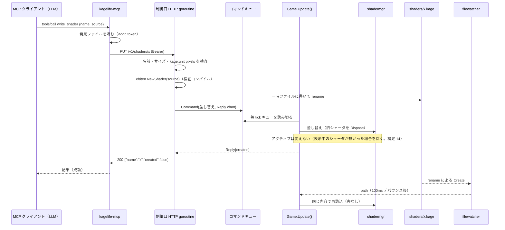
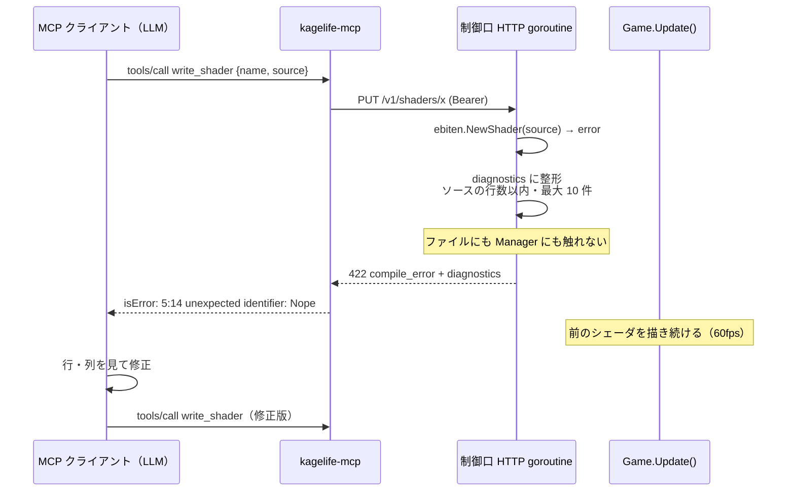

# ADR-006: 制御口 v1 の契約 — localhost HTTP/JSON ＋ Update キュー

**ステータス**: Accepted
**日付**: 2026-09-30（改訂: 2026-10-01。BPM の扱いを ADR-008 D3 に合わせた。PRD Q-008／2026-10-02。制御口 v1 の実装（PR #24）に合わせ、補足 14 の理由を直し、補足 16〜18（コンパイルに失敗したファイル、フェード中の再指示、`last_error.message` の形）を追加した／2026-10-22。#24 のマージ前に入れる補足 19・20（未知のフィールドの拒否、`features`）を追加した。2026-10-19 の決定、PRD v0.5 FR-140・FR-141）／2026-11-09。マージ済みの LLM 背景スロット（PR #33、`-llm-slots`）に合わせ、state の `llm_slots`、`features` の `llm_slots`、PUT の 403 `forbidden_name`・409 `slot_live` と判定の順を書き足し、補足 21〜26 を追加した。補足 20 の「v1 の時点では空配列」を改めた）
**決定者**: cyokozai
**関連**: ADR-002（fsnotify + buffered channel）、ADR-005（プロセス構成）、[ADR-008](ADR-008-crossfade-compositing.md)（クロスフェードと BPM の既定値・制限）、assumptions-20260930 #4 #5 #10

---

## コンテキスト

ADR-005 で、常駐 GUI（`cyokozai/kagelife`）の制御口へ、別リポジトリ `cyokozai/kagelife-mcp` の別バイナリ `kagelife-mcp` が中継する構成を採った。
kagelife の feat/mcp-control-api（GUI 側）と kagelife-mcp の feat/mcp-stdio-server（中継側）を並行して作るため、両者の共通仕様を先に固定する。
本 ADR の「契約」節を制御口 v1 の**正典**とする。契約はリポジトリをまたぐので、kagelife-mcp 側には複製せず本 ADR を参照させ、版の食い違いは発見ファイルの `version` で検出する。

設計上の制約:
- Ebitengine の `Image` の描画操作と `ReadPixels` は `Update` / `Draw` の中でしか安全に扱えない。`ebiten.NewShader` だけは別 goroutine からでも安全（PoC で確認。RunGame 前・別 goroutine からでも同期的にコンパイルし、`行:列: メッセージ` 形式のエラーを返す）
- 現状の `Update()` は watcher の `chan string`（容量 8）を 1 tick に 1 件だけ非ブロッキングで受け取る
- LLM が任意のコードを書く。制御口は同じマシンの他のプロセスからも届く

## 検討した選択肢

### 待受と認証
- **A: 127.0.0.1 限定 + 起動時トークン（採用）** — 他ホストからは届かない。同じマシンの他プロセスやブラウザも、トークンを知らなければ操作できない
- B: 127.0.0.1 限定・認証なし — 同じマシンのどのプロセスからでも書き込める。LLM が書くコードの経路としては緩すぎる
- C: Unix ドメインソケット — ファイル権限で守れるが、HTTP クライアントとテスト（`httptest`）の素直さを失う

### ゲームループへの渡し方
- **A: 返信チャネル付きコマンドを Update がキューから読み切る（採用）** — ADR-002 の「channel に一本化」の延長。mutex を使わない
- B: `sync.Mutex` で Manager を共有 — ADR-002 で退けたのと同じ理由（ループ内のロック待ちでフレームを落とす）で却下

### エラーの返し方
- **A: ソースの行の範囲内・最大 10 件に絞った diagnostics（採用）**
- B: Ebitengine のエラーをそのまま返す — 構文エラーは内部のブリッジコードを連結して解析されるため件数が膨らむ（PoC で 127 件の例）。範囲外の行は LLM には直しようがなく、会話の文脈を無駄に使う

## 決定

**127.0.0.1 限定・トークン認証の HTTP/JSON 制御口を置き、要求は返信チャネル付きのコマンドとして `Update()` がキューから読み切って処理する。以下の契約を v1 とする。**

---

## 契約（制御口 v1）

### 接続
- 待受: 127.0.0.1 のみ。GUI のフラグ `-control-addr`（既定 `127.0.0.1:0` = 空きポート）。ループバック以外を指定したら起動エラー（判定は IP リテラルだけ。補足 9）
- 発見ファイル: GUI 起動時に JSON を 0600 で書く
  ```json
  {"addr":"127.0.0.1:NNNNN","token":"<32バイト乱数の hex 64 文字>","pid":123,"shader_dir":"/abs/path/shaders","version":1}
  ```
  場所: 環境変数 `KAGELIFE_CONTROL_FILE`、無ければ `filepath.Join(os.UserCacheDir(), "kagelife", "control.json")`。GUI 正常終了時に削除（token が自分のものと一致するときだけ。補足 13）。`version` は 1 固定で、クライアントは 1 以外を受け付けない（補足 15）
- 認証: 全リクエストに `Authorization: Bearer <token>`。不一致・欠落は 401 `unauthorized`
- 形式: リクエスト・レスポンスとも `application/json`
- 要求本文の JSON に契約に無いフィールドがあれば 400 `invalid_request`（message にフィールド名。補足 19）。応答の側は後からフィールドが増えうるので、クライアントは知らないフィールドを無視する
- 任意機能の有無は `GET /v1/state` の `features` で示す。`version` は上げない（補足 20）
- エラー共通形: `{"error":"<code>","message":"<人間/LLM 向けの説明>"}`（`compile_error` のみ `diagnostics` を追加）
- ゲームループが 2 秒以内に応答しなければ 503 `loop_timeout`
- 未定義パスは 404 `not_found`、メソッド違いは 405 `method_not_allowed`

### シェーダ名
- 正規表現 `^[a-z0-9][a-z0-9_-]{0,63}$`（拡張子なし）。ファイルは `<shader_dir>/<name>.kage`。違反は 400 `invalid_name`
- 既存ファイルの名前はファイル名から `.kage` を除いたもの（例: `01_uv`）
- パス区切り・`.` を含む名前は正規表現で弾かれるので、書き込みは `shaders/` 直下に限られる
- 名前検査は GET・PUT・switch・crossfade のすべてに適用し、エスケープはデコードしてから検査する（補足 3）

### エンドポイント

#### GET /v1/state
200:
```json
{"active":"01_uv","shaders":["01_uv","02_time_sin"],"bpm":120.0,"bpm_measured":false,
 "fade":{"fading":false,"target":"","mix":0.0,"beats":4.0},
 "fps":59.9,"resolution":[1280,720],
 "last_error":null,"features":["llm_slots"],"llm_slots":[]}
```
`last_error` は `{"shader":"x","message":"..."}` または null（ファイル監視経由のコンパイル失敗も含む最新のもの。寿命は補足 8、`message` の形は経路で異なる: 補足 18）。`active` はシェーダ 0 本なら `""`。
`shaders` はファイル名順で、コンパイルに失敗したファイルも含む（補足 16）。
`bpm` は常に 40〜300 で、0（未設定）にはならない。タップ前は既定の 120（[ADR-008](ADR-008-crossfade-compositing.md) D3）。`bpm_measured` は、`bpm` が既定値のままなら false、タップまたは `POST /v1/bpm` で設定された値なら true（`tempo.Tapper.Measured()` に当たる）。
`features` は常に配列で、GUI が持つ任意機能の snake_case の名前を並べる（補足 20）。今は `["llm_slots"]` で、`-llm-slots` を付けずに起動しても同じ（ビルドが機能を持つことだけを示す。補足 21）。
`llm_slots` は `-llm-slots` の予約名をフラグの順に並べた配列で、フラグ無しなら `[]`（null にしない。補足 22）。

#### GET /v1/shaders/{name}
200 `{"name":"x","source":"..."}` / 404 `not_found`

#### PUT /v1/shaders/{name}
body `{"source":"..."}`。処理順:
1. 名前検査 → 400 `invalid_name`
2. `-llm-slots` を付けて起動したときだけ: 予約名以外 → 403 `forbidden_name`、映っている予約名 → 409 `slot_live`。本文は読まない（補足 23。「映っている」は補足 24）
3. 本文の解析（不正な JSON・未知のフィールド・`source` の欠落 → 400 `invalid_request`、本文全体が 1MiB 超 → 413 `too_large`）。source が 64KiB 超 → 413 `too_large`
4. `//kage:unit pixels` の行が無い → 422 `unit_pixels_required`
5. コンパイル（ファイルより先）。失敗 → ファイルに触れず 422:
   ```json
   {"error":"compile_error","message":"<整えた要約>","diagnostics":[{"line":5,"col":14,"message":"unexpected identifier: Nope"}]}
   ```
   - diagnostics はソースの行数以内のものだけ（Ebitengine は内部コードを連結して解析するため、範囲外の行は捨てる）。最大 10 件
   - 構文エラーは `errors.As(err, *scanner.ErrorList)` で取れる。意味エラーは文字列 `行:列: メッセージ`（改行区切り）を解析する。どちらにも当たらないものは `line=0,col=0` で message にそのまま入れる
6. `-llm-slots` を付けて起動したときだけ: 書く直前に、映っているかをもう一度確かめる → 映っていれば 409 `slot_live`（ファイルに触れず、コンパイル済みのシェーダは捨てる。補足 23）
7. 成功 → `<shader_dir>/<name>.kage` に書き込み（同ディレクトリの一時ファイル＋rename）、Manager で差し替え（無ければファイル名順の位置に追加。2026-10-02 改訂、旧版は「末尾に追加」）。
   200 `{"name":"x","created":true}`（新規なら true、既存の差し替えなら false。ファイル基準: 補足 7）
   直後に fsnotify 経由で同じファイルが再読込されても害が無いこと
   成功してもアクティブにはしない（表示中のシェーダが無い状態を除く。補足 14）

#### POST /v1/switch
body `{"name":"x"}` → 200 `{"active":"x"}` / 404 `not_found`（コンパイルに失敗したファイルも 404。補足 16）

#### POST /v1/crossfade
body `{"name":"x","beats":4}`（beats 省略時は現在の FadeBeats。指定時は 0 < beats <= 64）。
200 `{"target":"x","beats":4.0}` / 404 `not_found` / 400 `invalid_beats`。
BPM は常に 40〜300 で 0 にならないため、BPM を理由に失敗することはない（タップ前は既定の 120 BPM で進む。[ADR-008](ADR-008-crossfade-compositing.md) D3）。
判定順は 名前 400 → beats 400 → 未読込 404（補足 4。コンパイルに失敗したファイルも未読込として 404: 補足 16）。beats 指定はプリセットを変えない（補足 5）。フェードしていない active への crossfade は何もせず 200（補足 6）。フェード中の再指示は [ADR-008](ADR-008-crossfade-compositing.md) D2 に従う（補足 17）

#### POST /v1/bpm
body `{"bpm":128}` → 40〜300 以外は 400 `invalid_bpm`。200 `{"bpm":128.0}`。
範囲はタップ BPM の制限と同じ（[ADR-008](ADR-008-crossfade-compositing.md) D3）。タップ BPM と共存する。以後のタップで上書きされてよい

### Stream Deck 用の任意機能（2026-11-11 追加。補足 27〜33）

同じ機械に挿した Stream Deck MK.2（キー画像 72×72）の常駐アプリ（別リポジトリ `cyokozai/kagelife-deck`）から使う 2 つの任意機能。
どちらも `features` に名前を出し（補足 27）、発見ファイルの `version` は 1 のまま。
番号は PR #42（LLM 背景スロット）の補足 21〜26 から続ける。この節を補足の並びの末尾に置かないのは、#42 と同じ場所に書き足して衝突させないためである。

#### GET /v1/previews（feature `previews`）
要求本文は無い。クエリは見ない（知らないクエリも無視して 200）。200:
```json
{"size":72,"fps":10,"frame":123,
 "keys":[{"key":"1","name":"01_uv","jpeg":"<base64 の 72x72 JPEG>","compile_error":false}]}
```
- `keys` はキーの順（"1"〜"9"）で、GUI の数字キーと同じ対応（ファイル名順。`-llm-slots` 有りなら 1〜7 が予約名以外、8・9 が予約名）。割り当ての無い数字は出さない。割り当てが無ければ `[]`（null にしない）
- `jpeg` は 72×72 の JPEG（品質 80）の base64。まだ描いていないとき、コンパイルに失敗したスロットでは null。`compile_error` はその 2 つを区別する
- `frame` はプレビューを描くたびに 1 増える。起動直後は 0
- 描く条件と最初の要求の扱いは補足 28、描く中身は補足 29
- GUI を `-previews=false` で起動すると 404 `not_found`（未定義パスと同じ）で、`features` に `previews` を出さない（補足 32）

#### POST /v1/keys（feature `keys`）
body `{"key":"1","shift":false}`（`shift` は省略可、既定 false）→ 200 `{"key":"1"}`。
- `key` は `"0"`〜`"9"`・`"["`・`"]"` のどれか。それ以外は 400 `invalid_key`
- 割り当ての無い数字は 404 `not_found`（`-llm-slots` 無しのときのキー 0 を含む）
- 判定順は 本文 400 `invalid_request`（不正な JSON・`key` の欠落・型違い・未知のフィールド）→ 400 `invalid_key` → 404 `not_found`
- 挙動は補足 30

27. **`features` の `keys`・`previews`**: `features` は `["keys","llm_slots","previews"]` を返す（名前順）。`keys` はこのビルドが機能を持つことだけを示し、起動時のフラグでは変わらない。`previews` は `-previews=false` のときだけ出さない（補足 32）
28. **プレビューを描く条件**: GUI は、直近 2 秒以内に `GET /v1/previews` が来ているときだけプレビューを描く。来ていなければ GPU も CPU も追加で使わない。描く頻度は最大 10 fps
    - 止まっている状態（起動直後、または 2 秒以上要求が無かった）からの最初の要求は、ゲームループから今の割り当てを読み、`jpeg` をすべて null にして即答する。前に描いた古い絵は返さない。この要求で描き始める。ゲームループが止まっていれば 503 `loop_timeout`
    - 描いている間の要求は、最新の完成したフレームをそのまま返す（ゲームループを待たない）
    - 401 で断った要求では描き始めない
29. **プレビューの中身**: 各キーのスロットのシェーダを、そのフレームの本番の出力と同じ `Time`・`Beat`・`Frame`・`Random` で描く。`Resolution` は 72×72、`Cursor` は画面の座標を 72×72 へ縮めた値。クロスフェードは描かず、スロットごとのシェーダをそのまま描く
    - 毎回そのときのスロットのシェーダを描くので、`PUT /v1/shaders/{name}` やファイル監視で差し替えたシェーダは、次のプレビューフレームから新しい中身で描かれる
    - 割り当て（どのキーがどのシェーダか）も描くたびに読み直す。ファイルの追加・削除でキーがずれたら、`name` もずれる
    - アルファが 1 未満の画素は黒の上に重ねた色になる（JPEG に透過は無い）
30. **キーの挙動**: GUI のキーボードでそのキーを押したのと同じ関数を、ゲームループ（Update キュー）の上で呼ぶ。挙動はキーボードと同じで、ここでは二重に定めない
    - 数字は即時切替、`shift` が true なら Shift＋数字（クロスフェード、プリセットの拍数）
    - キー 0（`-llm-slots` 有りのときだけ）は直前に映っていた予約名以外のシェーダへの即時切替。戻り先は、その要求を処理する時点の表示も含めて記録してから選ぶ（キーボードと同じく、押す直前の表示を記録する）。`shift` は見ない
    - `[` `]` はプリセットの拍数を 1 段変える。`shift` は見ない
    - 割り当てはあるがコンパイルに失敗したスロットのキーは、キーボードと同じく何もしないで 200 を返す。戻り先が無いときのキー 0 も同じ。実際に切り替わったかは `GET /v1/state` で確かめる
31. **実装の注記（契約ではない）**: 9 個を 1 枚の 216×216 のアトラスに描き、GPU からの読み出しは 1 プレビューフレームにつき 1 回。読み出し（`ReadPixels`）は積んである描画命令をすべて流して待つので、Draw の中で本番の描画を積む前に行う。JPEG の符号化はゲームループの外（別 goroutine）で行い、符号化が終わるまで次のプレビューを描かない。セルとアトラスの画像は Ebitengine の内部のテクスチャアトラスに載せない（`Unmanaged`）。載せると `dstPos` に詰めた位置が足され、`dstPos / Resolution` で座標を出すシェーダの絵がずれる
32. **`-previews` フラグ**: GUI の `-previews`（既定 true）を false にすると、プレビューを描かず、`GET /v1/previews` は 404 `not_found`、`features` に `previews` を出さない。デッキは `features` を見て、キーの表示を文字に戻す。`keys` は止めない（`-previews=false` でも `POST /v1/keys` は使える）
33. **予約 uniform の型違い**: 予約 uniform の名前で型の違う宣言（例: `var Time vec2`、`var Resolution vec3`）は Kage のコンパイルを通るが、Ebitengine は描くときに panic する。GUI はこれを描く前に弾き、コンパイル失敗と同じに扱う。型は `Time`・`Beat`・`Random` が float、`Frame` が int、`Resolution`・`Cursor` が vec2
    - ファイル監視の読み込み・再読込: 1×1 に試し描きして panic すれば、コンパイル失敗と同じ（旧シェーダのまま、新しいファイルは nil のスロット、`last_error` に記録）。`message` に uniform の型が合わないことを書く
    - PUT: コンパイルの後、書く前にゲームループで試し描きする。型違いなら 422 `compile_error`（ファイルにも Manager にも触れない。`diagnostics` は位置不明として line 0 / col 0 の 1 件）。このため PUT はゲームループを 1 回多く待つ（`-llm-slots` 付きなら最大 4 回）。ループが止まっていて試し描きできなければ飛ばして書き、差し替えの処理でもう一度確かめる（そこで型違いなら 422 で、ファイルは書いてあるが Manager には入らない。ファイル監視の再読込でもコンパイル失敗になる）
    - プレビュー: それでも描くときに panic したキーは、そのキーだけ `compile_error: true`・`jpeg: null` にして、他のキーは描き続ける

### v1 の範囲外（後続 PR）
- `GET /v1/capture?max_width=1024&format=png|jpeg`（feat/mcp-capture-frame）
- `POST /v1/uniforms`、state への uniform 一覧（feat/mcp-uniform-params）

これらは v1 では 404 のままでよい。

### Kage の予約 uniform（GUI が毎フレーム渡す）
`Time float` / `Resolution vec2` / `Beat float`（拍内位相 0〜1） / `Cursor vec2` / `Frame int` / `Random float`

### エラーコード一覧

| HTTP | error | 発生条件 |
|------|-------|---------|
| 400 | `invalid_request` | JSON 本文が不正、必須項目が欠けている、または契約に無いフィールドがある（message にフィールド名。補足 19） |
| 400 | `invalid_name` | シェーダ名が正規表現に合わない（GET・PUT・switch・crossfade。エスケープはデコードしてから検査） |
| 400 | `invalid_key` | POST /v1/keys の `key` が `"0"`〜`"9"`・`"["`・`"]"` のどれでもない。割り当ての無い数字は 404 `not_found`（補足 30） |
| 400 | `invalid_beats` | beats が 0 以下または 64 超 |
| 400 | `invalid_bpm` | bpm が 40〜300 の外 |
| 401 | `unauthorized` | トークンの欠落・不一致 |
| 403 | `forbidden_name` | `-llm-slots` を付けて起動した GUI への PUT で、名前が予約名でない（補足 23） |
| 404 | `not_found` | シェーダが無い、または未定義パス。switch・crossfade では、コンパイルに失敗したファイルも含む（補足 16） |
| 405 | `method_not_allowed` | メソッド違い |
| 409 | `slot_live` | `-llm-slots` を付けて起動した GUI への PUT で、予約名が映っている（補足 23・24） |
| 413 | `too_large` | ソースが 64KiB 超、または JSON 本文全体が 1MiB 超 |
| 422 | `unit_pixels_required` | `//kage:unit pixels` の行が無い |
| 422 | `compile_error` | コンパイル失敗（`diagnostics` 付き） |
| 500 | `internal_error` | ファイルの読み書きに失敗した |
| 503 | `loop_timeout` | ゲームループが 2 秒以内に応答しない |

### 補足（2026-09-30 確定）

feat/mcp-control-api の実装で確定した補足。本節と実装が食い違うときは実装を正とし、本節を直す。

1. **400 `invalid_request`**: JSON 本文が不正、または必須項目が欠けている
2. **500 `internal_error`**: ファイルの読み書きに失敗した
3. **名前検査の範囲**: 名前検査は PUT だけでなく、GET /v1/shaders/{name}、switch、crossfade の name にも適用する（400 `invalid_name`）。`..%2Fx` のようにエスケープされたものも、デコードしてから検査して 400 にする
4. **crossfade の判定順**: 名前検査 400 → beats 400 → 未読込 404（BPM は 0 にならないので BPM による失敗は無い。2026-10-01 改訂）
5. **beats とプリセット**: beats を指定した crossfade はプリセット（`[` `]` で変える拍数）を変えない。state の `fade.beats` は、指定付きのフェード中はその値、それ以外はプリセットの値を返す
6. **active への crossfade**: 今フェードしていない状態で active と同じシェーダへ crossfade すると何も起きない。それでも 200 を返す
7. **`created` の基準**: ファイル基準。rename の前にファイルが無ければ true
8. **`last_error` の寿命**: コンパイルに失敗するたびに上書きし、どのシェーダでも次にコンパイルが成功したら null に戻る。PUT の失敗も記録する。ただし、起動時の読み込みで失敗したシェーダは `last_error` に入らず、ログにだけ出る
9. **ループバックの判定**: IP リテラルだけで判定する（127.0.0.0/8 と ::1）。`localhost` や `0.0.0.0` は起動エラー
10. **範囲外だけの diagnostics**: diagnostics が全件ソースの行の範囲外のときは、先頭の 1 件を line 0 / col 0 として返す（空の配列にはしない）
11. **PUT の loop_timeout**: PUT が `loop_timeout` になった場合、ファイルは書き込み済みである。反映はファイル監視に任せる（`-llm-slots` を付けたときは、書く前の判定で 503 になるとファイルは書かれない。補足 26）
12. **本文の上限**: JSON 本文全体の上限は 1MiB（413 `too_large`）。source 単体は 64KiB まで
13. **発見ファイルの削除**: 終了時の削除は、ファイルの中の token が自分のものと一致するときだけ行う（後から起動した別の GUI の発見ファイルを消さない）
14. **PUT とアクティブ**: PUT は成功してもアクティブにしない（切り替えは switch / crossfade で行う）。例外として、表示中のシェーダが無い状態で PUT が成功すると、そのシェーダが表示される。表示中のシェーダが無い状態とは、A（アクティブ）がシェーダを持たないスロット（コンパイルに失敗したファイルの nil のスロット）を指している状態、またはスロットが 0 本の状態で、シェーダが 0 本のときだけでなく、全ファイルがコンパイルに失敗したときも当たる。shadermgr は A が nil のスロットを指しているときに限り、差し替えに成功したスロットへ A を寄せる（A がシェーダを持つなら動かさない。ファイル監視経由の再読込の成功も同じ規則）。（2026-10-02 改訂。旧版の理由「Manager は常に index 0 を表示する」はファイル名順のスロット固定の導入で古くなった）
15. **発見ファイルの `version`**: 1 に固定する。クライアント（`kagelife-mcp`）は 1 以外を受け付けない

### 補足（2026-10-02 追加）

制御口 v1 の実装（PR #24、ファイル名順のスロット固定・nil のスロット・フェード中の再指示・A の寄せを持つ shadermgr の上に作り直したもの）で見つかった、契約の書き足し。番号は補足 1〜15 から続ける。

16. **コンパイルに失敗したファイル**: `shader_dir` にあってもコンパイルに失敗しているファイル（起動時の読み込みやファイル監視での失敗。shadermgr の nil のスロット）は、`GET /v1/state` の `shaders` にファイル名順で出るが、switch / crossfade では読み込まれていないものとして 404 `not_found` を返す（message で `last_error` を見るよう促す）。`GET /v1/shaders/{name}` はファイル基準なので、この場合も 200 でソースを返す。PUT のコンパイル失敗はファイルにも Manager にも触れないため、新しい名前なら `shaders` にも出ない。全ファイルがコンパイルに失敗している状態では、`active` は `""` ではなく A が指す nil のスロットの名前になる（`active` が `""` になるのはスロットが 0 本のときだけ）
17. **フェード中の再指示**: フェード中の crossfade は [ADR-008](ADR-008-crossfade-compositing.md) D2 の規則に従う（キー操作と同じ shadermgr の規則。beats を指定しても同じ）
    - 進行中のフェードの B と同じ先: 無視してフェードを続ける。200 の `beats` は進行中のフェードの拍数を返す（新しく指定した beats は使わない）
    - Mix < 0.5 で、元の A: フェードを取りやめ、A のままにする。200 を返す
    - 上記以外で Mix ≥ 0.5: B を確定させて新しい A とし、そこから指示先へのフェードを 0 から始める
    - 上記以外で Mix < 0.5: A のままにして、指示先へのフェードを 0 から始める

    どの場合も 200 の `target` は指示した名前である。取りやめたか、どこからフェードしているかは `GET /v1/state` の `active` と `fade` で確かめる。フェードしていないときの active への指示は補足 6
18. **`last_error.message` の形**: 記録した経路で形が異なる。クライアントは `message` を解析せず、位置が要るときは PUT の `diagnostics` を使う
    - ファイル監視経由のコンパイル失敗: `shadermgr.CompileError` の形。各行が `<絶対パス>:<行>:<列>: <メッセージ>`、行・列の形に合わない行は `<絶対パス>: <メッセージ>` で、複数あれば改行区切り。行番号は Ebitengine が返したままで、diagnostics のようにソースの行の範囲内へ絞らない
    - ファイル監視経由の読み込み失敗（ファイルを読めない）: OS のエラー文（パスを含む）。補足 8 の「コンパイル失敗」に加えて、これも `last_error` を上書きする
    - PUT のコンパイル失敗: 422 の `message` と同じ diagnostics の要約。`shader compilation failed: <先頭の診断>` で、先頭の診断は `<行>:<列>: <メッセージ>`（位置不明ならメッセージのみ）、2 件以上なら末尾に ` (and <残りの件数> more)` が付く。パスは含まない

### 補足（2026-10-22 追加）

2026-10-19 の決定（PRD v0.5 FR-140・FR-141）。段階 3 の拡張（PRD §12 の A〜D）は既存の要求にフィールドを足していく（例: switch / crossfade の `at`）。
古い GUI が知らないフィールドを黙って無視すると、量子化を頼んだ操作が即時に実行されるといった食い違いが表に出ない。これを #24 のマージ前に塞ぐ。番号は補足 1〜18 から続ける。

19. **未知のフィールドの拒否**: 要求本文の JSON（PUT /v1/shaders/{name}、POST /v1/switch、POST /v1/crossfade、POST /v1/bpm と、今後足すエンドポイントのすべて）に、そのエンドポイントの契約に無いフィールドがあれば 400 `invalid_request` を返す。message には未知のフィールドの名前を入れる（例: `unknown field "at"`）。検査の順では JSON の解析の一部として、名前・beats・bpm などの値の検査より先に行う。応答の側はこの限りでない: GUI は応答にフィールドを足すことがあるので、クライアント（`kagelife-mcp`・指揮役）は応答の知らないフィールドを無視する
20. **`features`**: `GET /v1/state` に `features` を出す。常に配列で、null にも省略にもしない。要素は GUI が持つ任意機能の snake_case の名前（`^[a-z][a-z0-9_]*$`）で、並びは名前順。v1 の時点では空配列（2026-11-09 改訂: 今は `llm_slots` を持つ。補足 21）。任意機能を足す PR（PRD §12 の A〜D）は、その機能の名前を足し、本 ADR に名前と中身を書く（名前の一覧の置き場所は PRD Q-016）。クライアントは任意機能を使う前に `features` で有無を確かめ、無ければ GUI の版が古いことを `isError` で返す。発見ファイルの `version` は 1 のまま上げない。`version` は既存の要求・応答の意味が変わる非互換な変更のためにとっておき、機能の追加は `features` で示す

### 補足（2026-11-09 追加）

LLM 背景スロット（PR #33、マージ済み）の契約。GUI を `-llm-slots llm_a,llm_b` のように起動すると、LLM が書く名前を予約し、PUT をその名前だけに絞り、映っている予約名への書き込みを断る。一方を映している間にもう一方へ書かせ、書き終えたら crossfade で切り替える使い方を想定する。キー 8・9・0 の割り当ては GUI の操作で、制御口の契約ではない（README の「LLM 背景スロット」の節）。番号は補足 1〜20 から続ける。

21. **`features` の `llm_slots`**: `features` は今 `["llm_slots"]` を返す。これはこのビルドが LLM 背景スロットの機能を持つことだけを示し、`-llm-slots` を付けずに起動しても出る。予約名が設定されているかは state の `llm_slots` が空かどうかで見る（補足 22）。補足 20 の「v1 の時点では空配列」はこの機能の追加で改めた。発見ファイルの `version` は 1 のまま
22. **state の `llm_slots`**: `GET /v1/state` に `llm_slots` を出す。`-llm-slots` の予約名をフラグに書いた順に並べた配列で、フラグ無しなら `[]`（null にも省略にもしない）。`-llm-slots` の値はカンマ区切りで 1〜2 個、各名前はシェーダ名の正規表現 `^[a-z0-9][a-z0-9_-]{0,63}$`（拡張子なし）に合うこと。前後の空白は除く。3 個以上・規則違反・重複は起動エラー。予約名のファイルがまだ無くてもよい（`shaders` に出るのはファイルができてから）
23. **PUT の制限と判定の順**: `llm_slots` が空でなければ、PUT /v1/shaders/{name} は次の順で判定する。名前検査 400 `invalid_name` → 予約名以外 403 `forbidden_name` → 映っている予約名 409 `slot_live` → 本文（400 `invalid_request` / 413 `too_large` / 422 `unit_pixels_required` / 422 `compile_error`）→ 書く直前にもう一度 409 `slot_live`
    - 403 と 409 は本文を読む前に返す。本文が不正でも、1MiB を超えていても、先に 403 / 409 になる。補足 19 の「未知のフィールドの拒否は値の検査より先」は本文の中の順序で、パスの名前と予約名の判定は本文より先に行う
    - 403 は設定済みの予約名と比べるだけで、ゲームループを待たない。409 の判定はゲームループの上で行う（補足 24 の状態を読むため）
    - 書く直前の 2 回目の判定は、本文の読み込みとコンパイルの間に、その予約名が switch / crossfade / キー操作で映った場合に備える。ここで 409 になったらファイルにも Manager にも触れず、コンパイル済みのシェーダは捨てる
    - 403 の `message` は予約名の一覧を、409 の `message` は書いてよいもう一方の予約名を示す（予約名が 1 個なら、映らなくなるまで待つよう促す）
    - 制限するのは PUT だけ。GET /v1/shaders/{name}、switch、crossfade、bpm は `-llm-slots` の有無で変わらない。予約名への switch / crossfade もできる。表示中のシェーダが無い状態で予約名への PUT が成功すると表示される規則（補足 14）も同じ
    - フラグ無しなら 403 / 409 は出ず、PUT は今までどおりどの名前にも書ける
24. **「映っている」の定義**: 予約名 `name` が映っているとは、次のどちらかが成り立つこと（kagelife-mcp も同じ定義を使う）
    - state の `active` が `name` で、そのスロットのコンパイルに成功している（シェーダを持つ）。`active` がコンパイルに失敗したスロット（何も描かれていない nil のスロット。補足 16）を指しているなら、その名前は映っていない
    - `fade.fading` が true で、`fade.target` が `name`。フェードしていない間の `fade.target` の名残は映っていない扱いにする
25. **予約名が 1 個のとき・ループが止まっているとき**: 予約名は 1 個でもよいが、映っている間はその名前に書けない（409）ので、2 個を勧める（GUI も起動ログで勧める）。ゲームループが止まっているとき、予約名への PUT は 1 回目の 409 の判定で 503 `loop_timeout` になり、ファイルを書かない。予約名以外への PUT はループを待たないので、止まっていても 403 `forbidden_name` を返す
26. **PUT の待ち時間と 503**: `-llm-slots` を付けたときの PUT は、ゲームループを最大 3 回待ちうる（映っているかの判定 2 回と、Manager への差し替え 1 回）。待つたびに上限は 2 秒なので、ループが遅いと応答まで最大でおよそ 6 秒かかる。補足 11（503 でもファイルは書き込み済み）が当てはまるのは差し替えの待ちで 503 になった場合だけで、判定の待ちで 503 になった場合はファイルを書いていない。クライアントは 503 からはどちらかを区別できないので、必要なら GET /v1/shaders/{name} でソースを確かめる

---

## MCP ツールとの対応

`kagelife-mcp`（リポジトリ `cyokozai/kagelife-mcp`）は次のように中継する。2xx 以外は `error` と `message`（`compile_error` なら `diagnostics` も）をテキストにして `isError` 付きで返し、LLM が読んで直せるようにする。

| ツール | 制御口 | 備考 |
|--------|--------|------|
| list_shaders | GET /v1/state | `shaders` と `active` を返す |
| read_shader | GET /v1/shaders/{name} | |
| write_shader | PUT /v1/shaders/{name} | 丸ごと置き換え |
| write_back_slot | GET /v1/state → PUT /v1/shaders/{name} | kagelife-mcp #3 で追加予定（未マージ）。`llm_slots` のうち映っていない側（補足 24）へ全文を書く。画面は切り替えないので、続けて crossfade を呼ぶ。`slot_live` なら state を 1 回だけ読み直して残りを試す。`llm_slots` が空の GUI には書かない |
| switch_shader | POST /v1/switch | |
| crossfade | POST /v1/crossfade | |
| set_bpm | POST /v1/bpm | |
| get_state | GET /v1/state | fps の低下で重いシェーダを知らせる |
| get_kage_guide | （呼ばない） | 言語の制約と予約 uniform を中継側が静的に返す。GUI 無しでも答える |
| capture_frame | GET /v1/capture | 後続（feat/mcp-capture-frame） |
| set_uniform | POST /v1/uniforms | 後続（feat/mcp-uniform-params） |

---

## シーケンス: write_shader

処理の置き場所の目安。コンパイル（`NewShader`）は別 goroutine でも安全なので HTTP goroutine で行い、
Manager の状態変更（差し替え・`Dispose`）は `Update()` の中だけで行う。

### 成功



### 失敗（コンパイルエラー）



---

## 理由

- **localhost 限定**: MVP にリモート操作の要件は無い。待受をループバックに閉じれば、ネットワーク越しの攻撃面が生じない
- **トークン認証**: 同じマシンの他プロセスやブラウザからの要求を、トークンを知る `kagelife-mcp` だけに絞る。発見ファイルは 0600 で、トークンは起動のたびに変わる
- **Update キュー（ADR-002 の延長）**: ゲームループの外から状態を変える経路を、fsnotify と同じく channel に一本化する。返信チャネルを付けることで、ファイル経路では返せなかった成否を呼び出し側に返せる。1 tick に 1 件だけ受ける形では要求が溜まると反映が遅れるので、キューは毎 tick 読み切る。PoC（Xvfb）ではこの構成でシェーダ差し替えの往復が 17ms だった
- **コンパイルが先、ファイルは後**: 失敗したコードで作品ファイルを壊さない。人間のエディタで開いているファイルも、成功したときにしか書き換わらない
- **`//kage:unit pixels` 必須**: v2.10.4 は指定なし（texels）だと行番号が 4 行ずれ、LLM に返す diagnostics の位置が狂う。README の最小例も pixels を使っている
- **diagnostics の絞り込み**: 範囲外の行は LLM が直せない。件数を最大 10 件にして、会話の文脈を節約する
- **2 秒で loop_timeout**: ゲームループが止まっていても中継と MCP クライアントが待ち続けないようにする

## 影響・結果

**ポジティブ**:
- 並行 2 本（kagelife の feat/mcp-control-api、kagelife-mcp の feat/mcp-stdio-server）が本契約だけを見て作れる
- 制御口の検査・diagnostics 整形・認証は ebiten に依存しない形で書け、`httptest` とモックのコンパイラでテストできる

**ネガティブ**:
- `rename` による書き込みの直後に fsnotify が同じファイルを再読込する（害は無いが、コンパイルが 1 回余分に走る）
- 一時ファイルは `.kage` で終わらない名前にし、監視対象に拾われないようにする必要がある
- PUT が `loop_timeout` になったとき、ファイルは書き込み済みである。反映はファイル監視に任せる（補足 11。`-llm-slots` 付きでは書いていない場合もある: 補足 26）
- 契約をリポジトリをまたいで守る必要がある。kagelife-mcp 側は本 ADR を参照し、発見ファイルの `version` が 1 以外なら接続しない

**Action Items**:
- [ ] `Update()` の受け取りを「キューを読み切る」形に直す（制御口コマンド。watcher の受け取りも同様）
- [ ] diagnostics の整形をテストで固定する（構文エラー 127 件 → 範囲内のみ・最大 10 件）
- [ ] ループバック以外の `-control-addr` で起動エラーになることをテストする
- [ ] 発見ファイルが 0600 で書かれ、正常終了時に消えることをテストする（token が一致しないときは消さないことも）
- [ ] 補足 1〜15 をそれぞれテストで固定する（feat/mcp-control-api）
- [ ] 補足 14 の改訂と補足 16〜18 をテストで固定する（PR #24 の `internal/control` と `internal/shadermgr` のテスト）
- [ ] 補足 19・20 を #24 のマージ前に実装し、テストで固定する（各エンドポイントで未知のフィールドが 400 `invalid_request` になり message にフィールド名が入ること、`features` が空配列で出ること）
- [ ] kagelife-mcp #1 を補足 19・20 に追従させる（要求に余計なフィールドを送らない、応答の知らないフィールドを無視する）
- [ ] 仕様の確認: 全ファイルがコンパイルに失敗した状態で `active` に switch できない nil のスロットの名前が入る（補足 16）。`active` を null にするか決める
- [ ] 補足 21〜26 のうち、PR #33 のテスト（`internal/control/llmslots_test.go`・`strict_test.go`）で固定されていないもの（書く直前の 2 回目の 409、503 になった待ちの位置とファイルの有無の対応）をテストで固定する
- [ ] kagelife-mcp #3（`write_back_slot`）のマージ後に、上の MCP ツールの表の「追加予定」を外す
