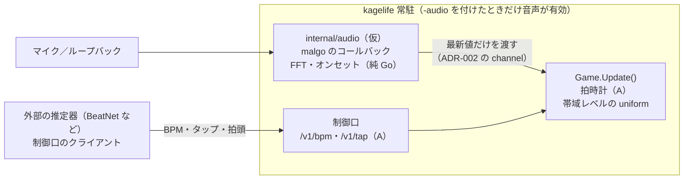

# ADR-009: 音声解析の置き場所 — 本体に同居（`-audio` を付けたときだけ有効）、重い解析は外部クライアント

**ステータス**: Accepted
**日付**: 2026-10-22（決定は 2026-10-19、2026-10-22 に置き場所を別リポジトリから本体への同居に変更）
**決定者**: cyokozai
**関連**: ADR-002（channel による受け渡し）、ADR-003（クロスプラットフォームとビルド方式 D4）、ADR-004（CI/CD とリリース）、ADR-005（プロセス構成）、ADR-006（制御口の契約）、ADR-007（kagelife-mcp の依存方針）、[ADR-010](ADR-010-autonomous-conductor.md)（自律演出の位置づけ）、PRD v0.5 §7・§12（FR-180〜FR-186、Q-011・Q-012・Q-017）

---

## コンテキスト

PRD v0.5 の段階 3 では、シェーダが曲に反応し、指揮役が曲に合わせて演出を組めるようにする。
そのために、マイクまたはループバック（再生中の音）を取り込み、FFT とオンセット検出で帯域レベルを求め、uniform として毎フレーム注入する（拡張 D）。
拡張 A の拍時計（量子化・演出キュー）と、音から取ったオンセットは、フレーム単位でそろっていることが望ましい。

設計上の制約:
- kagelife 本体は cgo=1 のネイティブビルドで 4 ターゲット（darwin/arm64・darwin/amd64・linux/amd64・linux/arm64）を作る（ADR-003 D4、ADR-004）。配布物は tar.gz の素のバイナリで、macOS の `.app` ではない
- 音声の取り込みには malgo（`github.com/gen2brain/malgo`、Unlicense。miniaudio を同梱）を使う見込みである。cgo の指定は Linux で `-ldl -lpthread -lm` だけで、音声のバックエンド（ALSA / PulseAudio / CoreAudio）は実行時に読み込むため、開発ヘッダは要らない。macOS でも framework の指定は無い
- CI の `.github/actions/setup-ebiten` は `libasound2-dev` を、`container/Dockerfile` は `alsa-lib-dev` をすでに入れている。malgo を足して増えるのは miniaudio.c のコンパイル時間だけである
- kagelife 本体の直接依存は ebiten / fsnotify / x/image で、これ以上足すときは ADR を起こす（PRD §7）。本 ADR がそれに当たる
- kagelife-mcp は cgo も ebiten も使わない純 Go である（ADR-005・ADR-007）
- 音声デバイスの不調（無い・許可が無い・途中で抜けた）で描画が止まってはならない
- macOS のマイクの利用許可は、素のバイナリでは起動したターミナルのアプリに付く見込みである（未確認。PRD Q-017）
- BPM の推定器のうち精度の高いもの（BeatNet などの Python の推定器）は重く、Go で書き直す対象ではない

## 検討した選択肢

### 選択肢 A: kagelife 本体に同居（採用）
**概要**: `internal/audio`（仮）で malgo を使って取り込み、FFT とオンセット検出は純 Go で書く。GUI のフラグ `-audio`（仮）を付けたときだけ有効にする。
**メリット**:
- 拍時計（拡張 A）とオンセットが同じプロセスの同じ時計で動き、フレーム単位でそろう。プロセス間の時刻合わせが要らない
- ライブではバイナリ 1 つで済む。起動するプロセスが増えない
- 制御口の契約が増えない（約 60Hz の新しい受け口を作らない）
- ビルド条件はほぼ増えない（malgo の cgo 指定は少なく、CI とコンテナは ALSA の開発パッケージをすでに入れている）
**デメリット**:
- go.mod に malgo が直接依存として入る
- C のコード（miniaudio）が描画と同じプロセスで動く。音声のコールバックのスレッドも同じプロセスに入る
- 将来 cgo 無しのクロスビルドへ寄せる場合（ADR-003 D4 は実機での起動が未確認のため採っていない）、音声の部分の扱いを別に考える必要がある

### 選択肢 B: kagelife-mcp（中継または指揮役）に同居
**デメリット**:
- kagelife-mcp の「cgo 無しの純 Go」（ADR-005・ADR-007）を崩す
- 中継は MCP クライアントの子プロセスで、クライアントの都合で終わる。取り込みを続けるプロセスとして寿命が合わない
- 拍時計とは別のプロセスなので、時刻合わせの問題が残る

### 選択肢 C: 別リポジトリの別プロセス（仮称 kagelife-ear）
**デメリット**:
- ライブでは GUI・指揮役・音声解析の 3 プロセスを起動することになる
- 拍時計とオンセットが別のプロセスの別の時計で動き、プロセス間の時刻合わせが要る
- 約 60Hz の帯域レベルを渡す新しい契約（HTTP か UDP か、認証、順序）が制御口に加わる
- リポジトリとリリースの系統が 1 つ増える
- macOS のマイクの利用許可は素のバイナリでは起動したターミナルのアプリに付く見込みで、別プロセスにしても GUI に許可が付かないという利点は無い（未確認）

### 選択肢 D: 同じリポジトリの別バイナリ（`cmd/kagelife-ear` など）
**デメリット**:
- プロセスが分かれるので、C と同じく時刻合わせと 60Hz の受け渡しの問題が残る
- 同じ Go モジュールに置けば依存は本体の go.mod に入り、A と比べた利点が無い

## 決定

**選択肢 A を採用する。音声の取り込みと軽い解析（FFT・オンセット検出）は kagelife 本体に同居させ、GUI のフラグ `-audio`（仮）を付けたときだけ有効にする。既定は無効。重い解析（BPM の推定器など）は外部のクライアントとし、制御口の既存の口に値を送る。**

### 取り決め
- **有効にする条件**: GUI のフラグ `-audio`（仮）を付けたときだけ取り込む。デバイスの指定を値に取るかは実装 PR で決める。付けなければ malgo のデバイスを開かず、帯域レベルの uniform は 0 のまま
- **受け渡し**: 音声のコールバックのスレッドから `Update()` へは、ADR-002 の「channel に一本化」に沿って最新値だけを渡す（古い値は捨てる）。`Update()` で mutex を待たない。細部は実装 PR で決める
- **解析の範囲**: 本体で行うのは FFT による帯域レベルとオンセット検出まで。どちらも純 Go で書く。BPM の推定器のような重い解析は本体に入れない
- **外部の推定器**: 重い解析は外部のクライアントとし、制御口の既存の口（`POST /v1/bpm`、拡張 A で足す `POST /v1/tap` と拍頭の指定）に値を送る。約 60Hz の新しい受け口は作らない。外部の推定器の値とタップの優先は PRD Q-012
- **障害時**: デバイスが無い・許可が無い・途中で抜けた場合も描画は止めない。HUD と state（または `last_error`）に出し、帯域レベルの uniform は 0 に戻す
- **`features`**: `-audio` で音声が有効なときだけ、`features` に D の名前（仮称 `audio`）を載せる（ADR-006 補足 20）
- **kagelife-mcp**: 音声を扱わない。純 Go を保つ

### 理由
- 拍時計（A）とオンセットが同じプロセスの同じ時計で動き、フレーム単位でそろう。別プロセスにすると、この時刻合わせが新しい課題になる
- ライブではバイナリ 1 つで済み、起動の手順が増えない
- 制御口の契約が増えない。重い解析は外部に出し、既存の `/v1/bpm` と拡張 A の口で受ける
- ビルド条件はほぼ増えない。malgo の cgo 指定は少なく、バックエンドは実行時に読み込み、CI とコンテナは ALSA の開発パッケージをすでに入れている
- 別プロセスにしてもマイクの利用許可の帰属は変わらない見込みで（Q-017）、分ける利点が残らない

### 前提条件
- 2026-10-19 のユーザー判断（PRD v0.5 の決定事項 2。置き場所は 2026-10-22 に別リポジトリから本体への同居に変えた）
- malgo の cgo 指定とバックエンドの読み込み方、CI とコンテナの既存のパッケージは main チャットが原本で確認した。4 ターゲットでの実際のビルドは実装 PR で確かめる
- Mac のループバック（PRD Q-011）とマイクの利用許可の帰属（PRD Q-017）は未確認

## 影響・結果

**ポジティブ**:
- 音への反応と拍時計がフレーム単位でそろう
- ライブで起動するプロセスが増えない。制御口の契約も増えない
- `-audio` を付けない限り、従来と同じ振る舞いになる

**ネガティブ**:
- go.mod に malgo が直接依存として入る（PRD §7 の「依存を足すときは ADR を起こす」に対し、本 ADR がそれに当たる）
- C のコード（miniaudio）が描画と同じプロセスで動く。既定で無効にして、使わない演者への影響を抑える
- miniaudio.c のコンパイル時間の分だけ、ビルドが長くなる
- 将来 cgo 無しのクロスビルドへ寄せるなら、音声の部分をビルドタグで外すなどの手当てが要る

**Action Items**:
- [ ] `internal/audio`（仮）を実装する（kagelife: feat/audio-input（仮））。malgo を go.mod に足し、PRD §7 の表を更新する
- [ ] 4 ターゲットのリリースビルドが malgo を入れても通ることを確かめる
- [ ] コールバックから `Update()` へ最新値だけを渡す形をテストで固定する
- [ ] デバイスが無い・許可が無い・途中で抜けたときに描画が止まらず、HUD と state に出ることを確かめる
- [ ] PRD Q-011（Mac のループバック）と Q-017（マイクの利用許可の帰属）を macOS 実機で確かめる
- [ ] 帯域レベルの uniform の名前を ADR-006 の予約 uniform と get_kage_guide に足す
