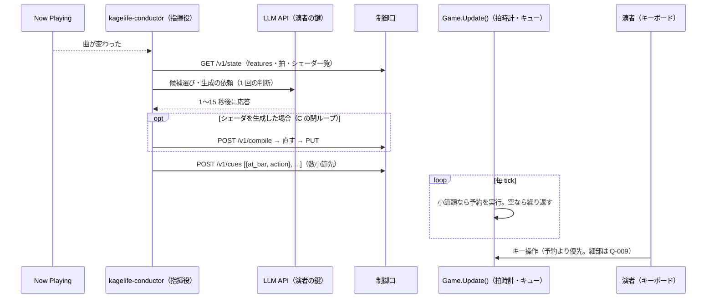

# ADR-010: 自律演出の位置づけ — LLM は予約し、GUI が拍で実行し、人の操作が優先する

**ステータス**: Accepted
**日付**: 2026-10-22（決定は 2026-10-19）
**決定者**: cyokozai
**関連**: ADR-005（プロセス構成）、ADR-006（制御口の契約）、ADR-007（kagelife-mcp の依存方針）、ADR-008（クロスフェードと BPM）、[ADR-009](ADR-009-audio-analysis-in-process.md)（音声解析の置き場所）、PRD v0.5 §12（FR-150〜FR-196、Q-009・Q-013〜Q-015）

---

## コンテキスト

段階 1・2 では、LLM（Claude Desktop / Claude Code）は演者の指示を受けて MCP のツールを呼ぶ。
段階 3 では、LLM が曲に合わせて自分から演出を変える（自律）。

設計上の制約:
- LLM の応答は 1〜15 秒かかる。120 BPM の 1 拍は 0.5 秒、1 小節は 2 秒で、どちらにも間に合わない
- 制御口の往復は速い（PoC で差し替え 17ms）が、HTTP の要求が届く時刻は拍と揃わない
- LLM の利用料が掛かる。自律にすると、演者が指示しなくても呼び出しが発生する
- 本番中は演者がキーボードで割り込む。自動の演出が人の選択を打ち消すと、演者が制御を失う
- MCP クライアントは stdio の子プロセスを起動するだけで、自分からは動かない（ADR-005）

## 検討した選択肢

### 拍に合わせる処理をどこに置くか

#### 選択肢 1: LLM が拍・小節ごとに即時の操作を呼ぶ
- 応答が 1〜15 秒なので拍にも小節にも間に合わない。呼び出しの回数（＝利用料）も拍の数だけ増える。却下

#### 選択肢 2: 指揮役が自分の拍時計を持ち、拍頭に合わせて即時の操作を送る
- LLM の遅れは吸収できるが、拍時計が GUI（タップ BPM・ADR-008 D3）と指揮役の 2 か所にでき、ずれる。HTTP の到着時刻の揺れが拍頭のずれになる
- 指揮役が落ちると、拍に合わせた演出がその場で止まる。却下

#### 選択肢 3: GUI が拍時計と演出キューを持ち、LLM は数小節先を予約する（採用）
- 拍時計は GUI の 1 か所だけ（タップ BPM と同じ時計）。量子化と予約の実行は `Update()` の中で行うので、拍頭・小節頭から 1 フレーム以内で揃う
- LLM の遅れは「数小節先」の余裕で吸収する。キューが空になったら繰り返すので、LLM・指揮役が遅れても落ちても演出は止まらない
- 代償: 制御口に拍時計（A）とキュー（B）の契約が加わる

### 自律の主体（指揮役）をどこに置くか

#### 選択肢 a: GUI 本体に LLM のクライアントを入れる
- 本体に LLM API の依存と鍵の扱いが入る。ネットワークの異常や鍵の誤りが描画と同じプロセスで起きる。ADR-005 で MCP を分けた理由と同じく却下

#### 選択肢 b: MCP クライアント（Claude Desktop / Claude Code）に任せる
- MCP クライアントは人の指示を待って動く。曲の変わり目を自分で検知して動き出す仕組みが無い。段階 1・2 の使い方としては残すが、自律の主体にはならない

#### 選択肢 c: kagelife-mcp リポジトリの別バイナリ `kagelife-conductor`（採用）
- 制御口のクライアント（発見ファイル・`version` 検査・`features` の確認）を `kagelife-mcp` と共有できる
- 純 Go のまま作れる（ADR-007 の方針）。GUI とは別プロセスなので、落ちても描画は止まらない
- 代償: 配布物がもう 1 つ増える（同じリポジトリから出す）

## 決定

**GUI が拍時計と演出キューを持ち、拍・小節に合わせた実行は GUI が行う。LLM は、kagelife-mcp リポジトリの別バイナリ `kagelife-conductor`（指揮役）から、曲の変わり目にだけ呼ばれ、数小節先の演出を予約する。人の操作は予約より優先する。**

### 取り決め
- **時間の分担**: 拍に合わせる処理（量子化・キューの実行）は GUI の `Update()` に置く。LLM は数小節先を予約するだけで、拍・小節ごとには呼ばない
- **映像の遅延補正**: 映像に出す拍（uniform・量子化・キューの実行）は、拍時計を「今 − offset」で評価する。会場の Bluetooth スピーカーの遅れに合わせるためで、タップ・set_bpm などの入力はずらさない（2026-11-06 追加。PRD FR-156・Q-018）
- **呼ぶ契機**: 指揮役が LLM を呼ぶのは、Now Playing で曲の変わり目を検知したときだけ。シェーダ生成の修正の往復は、その 1 回の判断に含める。取得手段は PRD Q-014
- **利用料と鍵**: 演者自身の API キーで払う。鍵は指揮役の環境変数でだけ受け取り、発見ファイル・ログ・制御口に載せない。kagelife 側は課金も立て替えもしない
- **人が優先**: 人の操作は予約より優先する。人がキー操作をした後、予約がその選択を上書きしない。キューを捨てるか止めるか、再開の条件、MCP 経由の人の指示を人の操作に含めるかは PRD Q-009 で、B の着手前に決める
- **止まらない**: キューが空になったら最後の一巡を繰り返す。指揮役が落ちても映像と予約済みの演出は続く
- **前提の確認**: 指揮役は `features` で A〜D が揃っているかを確かめてから動く（ADR-006 補足 20）
- **音との関係**: 音への即時の反応（帯域レベル・オンセット）は、本体に同居させた音声入力（`-audio`）が同じ拍時計の上で受け持つ（ADR-009）。外部の BPM の推定器は指揮役とは別のクライアントで、`/v1/bpm`・`/v1/tap` に値を送る
- **順序**: 前提の A〜D（拍時計、演出キュー、閉ループ、音声入力）を先に作り、指揮役（E）は A〜D の後に作る
- **AgentJev**: 小節ごとの選択に AgentJev（判断専用の 0.6B モデル）を足すかもしれない。E の着手時は、まず Jev 無しで作り、その後でライブで使う機体で計ってから決める（計り方は PRD Q-015）。Jev を足しても、拍に合わせた実行は GUI に置いたままにする

### 理由
- LLM の遅れ（1〜15 秒）と拍（0.5 秒）の差は、呼び出しを速くしても埋まらない。予約と実行を分けるしかない
- 拍時計を GUI の 1 か所に置けば、タップ BPM・set_bpm・量子化・キューが同じ時計で動き、ずれが生じない
- 呼ぶ契機を曲の変わり目に絞ると、呼び出しの回数が曲の数で上限を持ち、演者が払う利用料を見積もれる
- 人の操作を優先しないと、本番で演者が自動の演出と取り合いになる。演者が最後の決定権を持つことは段階 1・2（Appendix B の「キーで既知のシェーダに戻す」）から変えない
- 指揮役を別バイナリにするのは、ADR-005 で MCP を分けたのと同じく、障害と依存を描画から切り離すためである

### 前提条件
- 2026-10-19 のユーザー判断（PRD v0.5 の決定事項 1・4）
- LLM の応答時間（1〜15 秒）は調査時の見積もりで、指揮役の初版で実測する

## 影響・結果

**ポジティブ**:
- LLM の遅れが拍のずれにならない。指揮役が遅れても落ちても演出は止まらない
- LLM の呼び出しが曲の変わり目に限られ、利用料が曲の数に比例する
- 演者はいつでもキーで割り込める
- 拍時計と予約は、LLM を使わない演者（タップだけ、MCP 経由の手動の予約）にも使える

**ネガティブ**:
- 制御口に拍時計（A）とキュー（B）の契約が加わり、ADR-006 が育つ
- 配布物が増える（`kagelife-conductor`）。演者は指揮役を別に起動し、鍵を設定する
- 予約は数小節先なので、曲の展開への反応はその分遅れる（その場の反応は、本体に同居させた音声入力の帯域レベルの uniform（ADR-009）で補う）
- 人の操作と予約の優先の細部（Q-009）が決まるまで、B は着手できない

**Action Items**:
- [ ] PRD Q-013（拍子とフレーズの長さ）を A の着手前に決める
- [ ] PRD Q-009（キューと人の操作の優先の細部）を B の着手前に決める
- [ ] PRD Q-014（Now Playing の取得手段）を E の着手前に決める
- [ ] E の初版を AgentJev 無しで作り、LLM の応答時間と呼び出しの回数を実測する
- [ ] ライブで使う機体で AgentJev を計り、採否を決める（PRD Q-015）
