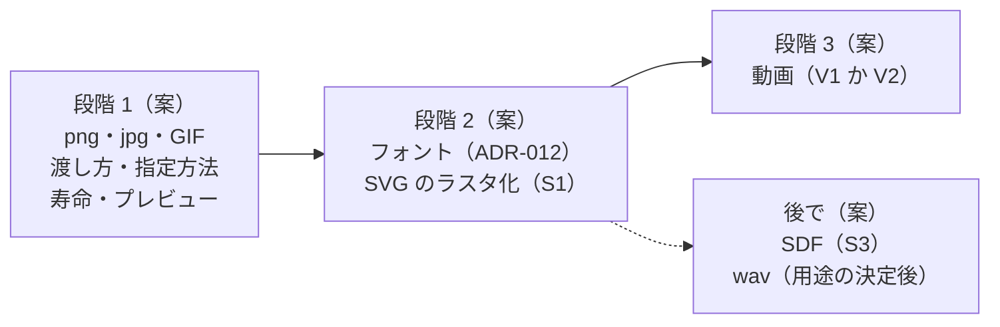

# ADR-011: メディア素材の読み込みとシェーダからの使い方 — 画像・GIF・SVG・動画・WAV

**ステータス**: 提案
**日付**: 2026-11-27
**決定者**: cyokozai（未決）
**関連**: ADR-002（ホットリロードと channel による受け渡し）、ADR-003（クロスプラットフォームとビルド方式 D4）、ADR-006（制御口の契約・予約 uniform・`features`・`llm_slots`）、[ADR-008](ADR-008-crossfade-compositing.md)（画面外合成）、[ADR-009](ADR-009-audio-analysis-in-process.md)（音声解析）、[ADR-012](ADR-012-fonts.md)（フォント）、PRD §7（外部依存）

---

## コンテキスト

依頼者の依頼は、画像（png・jpg・svg）、GIF、wav、mp4 などの動画を VJ の素材として扱えるようにすることである。
「VJ の素材として配置する」ことと「ベクトルの一部として使う」ことの両方を含む。既存の素材を活かした演出をできるようにする。

本 ADR は、素材の読み込み方、シェーダへの渡し方、配置のしかた、素材の指定方法、寿命とプレビュー・ホットリロードとの関係を論点ごとに並べる。
推奨は「案」として示す。決めるのは依頼者（cyokozai）である。

### 今の作り（origin/dev）

- シェーダには uniform だけを渡している。`DrawRectShader` の呼び出しは 3 行で、A 側（`main.go:627`）、クロスフェードの B 側（`main.go:636`）、`drawShaderSafe`（`uniformcheck.go:25`）である。`drawShaderSafe` は予約 uniform の型の試し描き（`uniformcheck.go:38-49`）とプレビュー（`previews.go:124`）が共有する。どれも `Images` を渡していない（`git grep "Images"` で該当なし）。**画像の枠は 4 枠のうち 0 枠を使っている**
- `drawShaderSafe` は描画中の panic を recover し、エラーとして返す（`uniformcheck.go:19-27`）。試し描きでこのエラーが出ると、コンパイル失敗と同じに扱う（`uniformcheck.go:53-64`、ADR-006 補足 33）
- シェーダの管理（`internal/shadermgr`）は、コンパイル関数 `ShaderCompiler func(src []byte) (Shader, error)`（`manager.go:16`）と、`Dispose()` だけを持つ `Shader` インターフェース（`manager.go:18`）で抽象化している。kagelife は `*ebiten.Shader` をそのまま渡している（`main.go:111`）。スロットの差し替え・取り除きで旧シェーダを `Dispose` する（`manager.go:113-115`、`manager.go:129-135`）
- シェーダの読み込みは `-shaders` のディレクトリの直下だけで、`.kage` 以外は読まない（`main.go:166-167`）。ファイル監視も `.kage` 以外と、`.`・`#` で始まる一時ファイルを捨てる（`internal/filewatcher/watcher.go:133-138`）
- プレビューは、要求が来ている間だけ最大 10 fps で、キー 1〜9 のシェーダを 72×72 のセルに描く（`internal/control/previews.go:22-24`、`previews.go:100-124`）
- 描画先の大きさは `-render-scale` で画面より小さくなることがある（`render.go:56-57`）
- 制御口の本文の上限は 1 MiB である（`internal/control/server.go:28`）。`-llm-slots` の予約名はシェーダ名の規則に合う 1〜2 個で、PUT はその名前だけに絞られる（ADR-006 補足 22・23）
- 素材のリポジトリ kagelife-shaders は「1 フォルダ = 1 プリセット」で、`.kage` をプリセットのフォルダの直下に置く。`//kage:unit pixels` を必須にしている（kagelife-shaders の `README.md`）。原作のあるプリセットには `NOTICE` を置いている（`presets/one-slit/NOTICE`）
- 直接依存は ebiten・fsnotify・malgo・x/image の 4 つ（`go.mod`）。直接依存を足すときは ADR を起こす（`docs/prd.md:282`）
- `get_kage_guide` は「画像入力は最大 4 枚」と返す（`docs/prd.md:483` FR-117）

### Ebitengine v2.10.5 の制約（モジュールのソースで確かめた）

- `DrawRectShaderOptions.Images` と `DrawTrianglesShaderOptions.Images` はどちらも `[4]*Image`（`image.go:750`、`image.go:1009`）。上限は `graphics.ShaderSrcImageCount = 4`（`internal/graphics/vertex.go:18`）。**1 回の描画でシェーダが読める画像は 4 枚まで**
- `DrawRectShader` は、渡す画像がすべて描く矩形と同じ大きさでないと panic する（`image.go:1098`、`"all the source images must be the same size with the rectangle"`）
- `DrawTrianglesShader` は pixel モードなら大きさの違う画像を渡せる（`image.go:747-749` のコメント）
- シェーダの中では `imageSrc0Size()`〜`imageSrc3Size()` で画像の大きさを読める（`internal/graphics/shader.go:144`）
- 画像の大きさの上限は機器ごとに違い、`ebiten.MaxImageSize` で読める（`image.go:1491`）

A と B は別々の描画なので、クロスフェード中は A と B がそれぞれ 4 枚ずつ、合わせて 8 枚を同時に使う。

## 論点 1: シェーダへの渡し方

### 選択肢 1A: `DrawRectShader` のまま、素材を描画先の大きさに描き直して渡す
**概要**: 素材を、描画先（`render.go` の w × h）と同じ大きさの画像に描き直し、`Images[0..3]` に入れる。
**メリット**:
- 今の 3 行の `DrawRectShader` の形を変えない
- シェーダでは素材の座標と画面の座標が一致する。`imageSrc0At(srcPos)` だけで書けるので、依頼者も LLM も書きやすい
**デメリット**:
- 画面の大きさや `-render-scale` が変わるたびに描き直す。GIF と動画は毎フレーム「元の大きさのフレーム → 描画先の大きさ」の描き直しが増える。コストは**測っていない**
- 描き直しの補間（`DrawImageOptions.Filter` の Nearest / Linear）は kagelife が決めることになり、ドット絵の素材がぼやける・縮小でちらつくなどがシェーダからは直せない
- はめ方（contain / cover / stretch）で生じる余白や切れた範囲を、シェーダは画像だけからは知れない。知らせるなら矩形を uniform で渡す（下の「追加の uniform」）
- 画面より大きい素材は縮むので、元の解像度は失われる

### 選択肢 1B: `DrawTrianglesShader` に替え、元の大きさのまま渡す
**概要**: 画面全体の四角形の頂点を自分で組み、pixel モードで大きさの違う素材を渡す。
**メリット**:
- 元の解像度を保てる。画面の大きさが変わっても素材を作り直さない
- 補間・はめ方・余白をシェーダが自分で決められる
**デメリット**:
- 3 行の `DrawRectShader`（A・B・`drawShaderSafe`）を替える。`drawShaderSafe` を通るプレビューと試し描きも変わる
- シェーダは `imageSrcNSize()` で座標を変換する必要があり、書くのが難しくなる
- 動作とコストは**確かめていない**

### 選択肢 1C: 複数の素材を 1 枚に詰める（アトラス）
**概要**: 複数の素材を 1 枚の画像に詰め、各素材の矩形を uniform の配列で渡す。1A・1B のどちらの上にも乗る。
**比較**:
- 1A・1B だけ: 1 シェーダ 4 枚まで。uniform の契約は増えない
- 1C を足す: 4 枚を超える素材を扱える。詰め方と矩形の uniform の契約が増え、素材の差し替えのたびにアトラスを作り直す。1A の上に乗せると、アトラス全体が描画先の大きさに縛られる

### 追加の uniform（1A・1B どちらでも）
素材について、シェーダが受け取る値を増やすかを決める。候補:
- 素材の大きさ（1B なら `imageSrcNSize()` で足りる。1A なら元の大きさは失われるので uniform で渡す）
- はめた矩形（1A の contain / cover で、素材が描画先のどこに入ったか）
- GIF・動画のフレーム番号と進行度（0〜1）

増やすなら ADR-006 の予約 uniform に足し、型違いの検査（補足 33）の対象にする。

**案**: 1A。シェーダの書きやすさと、今の描画の形を変えないことを取る。補間とはめ方は素材の指定（論点 3）で選べるようにし、はめた矩形と進行度は uniform で渡す。どちらのコストも未測定なので、実装 PR で 1A を測ってから確定する。

## 論点 2: 素材の配置（位置・回転・拡縮）

依頼の「VJ の素材として配置する」を、素材を画面のどこに・どの向き・どの大きさで置くかと読む。動かすのが誰かで選択肢が分かれる。

### 選択肢 2-1: シェーダが座標を変換する
**概要**: 本体は素材を論点 1 の形で渡すだけにし、位置・回転・拡縮はシェーダが `srcPos` を変換して決める。
**メリット**: 本体の機能が増えない。`Time`・`Beat`・音の uniform を使って自由に動かせる
**デメリット**: 置くだけでもシェーダを書く必要がある。演奏中に手で動かせない

### 選択肢 2-2: 本体が変換行列を持ち、uniform で渡す（またはシェーダの外で重ねる）
**概要**: 素材ごとの位置・回転・拡縮を本体が持ち、行列を uniform で渡す。またはシェーダの出力の上に `DrawImage` の `GeoM` で重ねる。
**メリット**: キー・制御口から演奏中に動かせる。シェーダを書かずに置ける
**デメリット**: 操作の手段（キー・制御口の口）と状態が増える。制御口から動かすなら新しい口が要る（論点 9）

### 拍との関係
- 動きを拍に合わせるか（例: 1 拍ごとに 90 度回す）。2-1 なら `Beat` で書ける。2-2 なら本体に拍で動かす仕組みが要る

**案**: 2-1 を先にし、演奏中の手操作が要るとわかったら 2-2 を別に検討する。どちらを望むかは依頼者に聞く。

## 論点 3: 素材の置き場所と指定方法

素材はプリセットのフォルダ（`-shaders` のディレクトリ）の直下に置く形が自然である。kagelife-shaders の「1 フォルダ = 1 プリセット」と合い、出所の表示（`NOTICE`）も同じフォルダに置ける。

### 選択肢 3A: シェーダのコメントで指定する
```
//kage:unit pixels
//kagelife:image0 logo.png fit=contain filter=nearest
//kagelife:image1 loop.gif
```
**メリット**: シェーダ 1 ファイルで完結する。LLM が `write_shader` で書くだけで素材を指定でき、制御口の契約を変えない。シェーダの保存と同時に素材も差し替わる
**デメリット**: 独自の書式を 1 つ増やす。Kage のコンパイラが `//kagelife:` で始まる行を通常のコメントとして無視するかは**確かめていない**

### 選択肢 3B: 同じ名前の付随ファイル（`foo.kage` と `foo.media.json` など）
**メリット**: Kage のソースに手を入れない
**デメリット**: ファイルが 2 つに分かれ、片方だけ書き換わる時間がある。`write_shader` では指定できない

### 選択肢 3C: 決まった名前（`image0.png`〜`image3.png`）をフォルダの全シェーダで共有
**メリット**: 書式が要らない
**デメリット**: 同じフォルダのシェーダが違う素材を使えない。形式が名前で決まらない（GIF か動画か）


### 相対パスの基準
- `.kage` のあるディレクトリを基準にする。今は `-shaders` の直下しか読まないので、`-shaders` を基準にした場合と結果は同じ
- 将来、サブディレクトリを読むようにした場合に食い違う。どちらを基準にするかを先に決める
- どちらの場合も、`-shaders` のディレクトリの外は指せないようにする（`..` と絶対パスは拒否）。制御口の PUT で書かれたシェーダに、任意のファイルを読ませないため

### `-llm-slots` の予約名との関係
- PUT は予約名の `.kage` しか書けない（ADR-006 補足 23）が、3A なら予約名のシェーダが `-shaders` の中のどの素材でも指定できる。素材を読める範囲を予約名ごとに絞るかを決める
- 素材のファイル名は、シェーダ名の規則（補足 22 の `^[a-z0-9][a-z0-9_-]{0,63}$`）と別の規則にするか、同じ規則に揃えるかを決める
- 制御口から素材を書く口は作らないので（論点 9）、`forbidden_name` の判定は今のまま変わらない

### shadermgr への影響（3A を取った場合）
コメントで素材を指定すると、スロットに入る値が「シェーダ」から「シェーダと素材の組」に変わる。
- `ShaderCompiler`（`manager.go:16`）は `.kage` のソースを受け取るので、素材の指定を読むことはできる。ただし素材の読み込みは時間がかかるので、コンパイルと同じ呼び出しの中で同期で読むかは論点 6 で決める
- `Shader` は `Dispose()` だけのインターフェース（`manager.go:18`）なので、組の型が `Dispose()` で素材も解放すれば、`Reload`・`Install`・`Remove` の差し替えと解放の流れはそのまま使える見込み（確かめていない）
- 描く側では、`ShaderAt`・`ActiveB`・`previewTargets`（`previews.go:25`）が返す値を `*ebiten.Shader` に型を合わせている所（例: `main.go:629` の `g.sm.ActiveB().(*ebiten.Shader)`）を、組の型に合わせて直す
- 制御口の `write_shader` は、コンパイルと試し描きを通ったものを Install する。素材が読めないとき・読み終わっていないときに 422 `compile_error` にするか、書き込みは成功させて素材のスロットを空にするかを決める
- 素材のファイルが無いときに試し描き（`drawShaderSafe`）が panic すると、`uniformcheck.go:22` の「uniform の型が合わない」という文のままコンパイル失敗になる。素材の不調は panic させない（空の画像を渡す）か、文を分ける

**どの案でも守ること（案）**:
- 素材が読めないときは、そのスロットを空（透明な黒）にして描画を止めず、HUD と `last_error` に出す（ADR-009 の障害時の扱いと揃える）

**案**: 3A。相対パスの基準は `.kage` のディレクトリ。

## 論点 4: 形式ごとの読み込み手段

| 形式 | 手段の候補 | 依存・ライセンス | cgo | ADR-003 への影響 |
|---|---|---|---|---|
| png / jpg | 標準ライブラリ `image/png`・`image/jpeg` | 追加なし | なし | なし |
| （おまけ）webp / bmp / tiff | `golang.org/x/image` の `webp`・`bmp`・`tiff`（既存の直接依存に含まれる。モジュールのディレクトリで確認） | 追加なし | なし | なし |
| GIF | 標準ライブラリ `image/gif` の `DecodeAll` | 追加なし | なし | なし |
| SVG | 下の S1〜S4 | S1 は `srwiley/oksvg`（BSD-3-Clause）を足す | 未確認（使わない見込み） | 未確認（小さい見込み） |
| mp4 | 下の V1〜V5 | 案による | 案による | 案による |
| wav | 下の W1〜W3 | 案による | 案による（oto を足すなら未確認） | 案による |

### png / jpg
標準ライブラリで読む。依存は増えない。jpg の EXIF の向きを標準ライブラリが反映するかは**確かめていない**。

### GIF
`image/gif.GIF` は、フレームごとの遅延（100 分の 1 秒単位）、`LoopCount`、`Disposal` を持つ（Go 1.27 の `src/image/gif/reader.go:585-596`）。
差分のフレームは `Disposal` に従って読み込み時に CPU で合成し、全フレームを元の大きさの `*ebiten.Image` として持つ。表示するフレームを毎フレーム選び、1A なら描画先の大きさに描き直す。
メモリは「フレーム数 × 幅 × 高さ × 4 バイト」。例（どれも計算値）:
- 480×270 で 100 フレーム: 51,840,000 バイト（約 52 MB）
- 480×270 で 10 秒・30 fps（300 フレーム）: 155,520,000 バイト（約 156 MB）
- 描画先の大きさ（1920×1080）で 100 フレームを持つと約 829 MB になるので、元の大きさで持つ

### SVG と「ベクトルの一部として使う」
「ベクトル」には 2 つの読み方がある。どちらを指すかは依頼者に確かめる。
- (i) ベクトル画像（SVG の形）をシェーダの数式に混ぜる（マスク・輪郭・光らせる・変形）
- (ii) 素材の画素を、ベクトル場（流れ・変位の向き）としてシェーダが読む。この場合は SVG に限らず、png などの RGB をベクトルとして読めば済み、論点 1 の範囲で書ける

(i) の手段:
- **S1 ラスタ化**: `srwiley/oksvg` でパスを読み、`srwiley/rasterx`（BSD-3-Clause。すでに間接依存。`go.mod`、`rasterx` の `LICENSE`）で描画先の大きさに塗る。oksvg は SVG 2.0 の一部の実装（https://github.com/srwiley/oksvg ）で、対応していない要素は同リポジトリの `doc` にある（中身は確かめていない）。Ebitengine も内部に oksvg の写しを持つが（`text/v2/internal/oksvg`）、`internal` なので kagelife からは import できない。oksvg は go.mod に直接依存として入る。保守の状況は確かめていない
- **S2 パスを頂点にする**: SVG のパスを Ebitengine の `vector.Path` に移し、`vector.FillPath`・`vector.StrokePath`（`vector/fill.go:81`、`vector/util.go:348`）で画像に描く。画面の大きさが変わっても形が崩れない。SVG の構文解析は別に要る（oksvg を使うか自分で書く）
- **S3 距離場（SDF）に変換して渡す**: S1 で塗った形から、各画素の輪郭までの距離を CPU で求め、画像として渡す。シェーダは `smoothstep` で輪郭線・光・太らせ・形の補間（モーフ）を書ける。距離の計算は読み込み時に 1 回で、計算量は画素数に比例する方法がある（実装は確かめていない）
- **S4 制御点を uniform の配列で渡す**: パスの点列をシェーダに渡し、シェーダの中で距離を求める。点の数が増えると画素ごとの計算量が増えるので、点数の上限が要る

**案**: 先に S1。演出の幅を広げるなら S3 を後に足す。

### mp4（H.264）
Go だけで H.264 を一般に復号できるライブラリは、調べた範囲では見つからなかった。
- `Eyevinn/hi264`: 純 Go の H.264 復号器だが、IDR と P_Skip のフレームだけ（https://pkg.go.dev/github.com/Eyevinn/hi264 ）
- `y9o/go-openh264`: purego で cgo を避けるが、実行時に OpenH264 の共有ライブラリが要る（https://pkg.go.dev/github.com/y9o/go-openh264 ）

手段の候補:
- **V1 ffmpeg を外部プロセスにして生のフレームを受ける**: `ffmpeg -i in.mp4 -f rawvideo -pix_fmt rgba -s WxH -` の出力をパイプで読む
  - メリット: mp4 をそのまま扱え、ほぼどの形式も読める。go.mod も cgo も増えない。ffmpeg とはリンクしない
  - デメリット: 本番の機材に ffmpeg が要る。無ければ動画だけ無効にする。ループや頭出しはプロセスの再起動になる。プロセスの後始末が要る
- **V2 事前に MPEG-1 へ変換し、`gen2brain/mpeg` で読む**: MIT、純 Go（一部アセンブリ。`noasm` タグで外せる）、MPEG-1 映像・MP2 音声・MPEG-PS だけ（https://github.com/gen2brain/mpeg ）。Ebitengine の動画の例がこの組み合わせで、変換の ffmpeg のコマンドも書いてある（`examples/video/main.go:70`、`examples/video/mpegplayer.go:25`）。Ebitengine の go.mod も require している（ebiten v2.10.5 の `go.mod`）
  - メリット: 本番で外部プロセスが要らない。cgo が増えない。4 ターゲットで同じ動き
  - デメリット: mp4 をそのまま置けず、準備の段階で変換が要る。同じ容量なら H.264 より画質が落ちる。go.mod に直接依存が 1 つ増える
- **V3 事前に連番画像へ変換**: 画像の読み込みをそのまま使える。素材の長さで量が決まる。VJ のループ素材は数秒〜十数秒のものが多いと**仮定**し、10 秒・30 fps（300 フレーム）で GIF と同じ計算をすると（計算値）:
  - 1280×720 の RGBA で全フレームをメモリに持つ: 3,686,400 × 300 = 1,105,920,000 バイト（約 1.1 GB）
  - 1920×1080 の RGBA で持つ: 8,294,400 × 300 = 2,488,320,000 バイト（約 2.5 GB）
  - 480×270 なら GIF と同じ約 156 MB
  - 全フレームを持たずにディスクから毎フレーム復号するなら、メモリは減るが、jpg・png の復号の CPU のコストが毎フレームかかる（未測定）。連番画像のディスク上の容量は確かめていない
- **V4 OS の復号器（macOS の VideoToolbox、Linux の VA-API など）**: OS ごとに別のコードになり、ADR-003 の 4 ターゲットで同じ作りという方針から外れる。手間が最も大きい
- **V5 go-openh264**: 実行時に共有ライブラリが要る。対応するプロファイルは確かめていない

**フレームの同期とメモリ（どの案でも）**:
- 復号は goroutine で行い、最新のフレームだけを `Update()` に渡す（ADR-002 の channel の形。ADR-009 の受け渡しと同じ）。古いフレームは捨て、描画の速さを復号に引きずらせない
- アップロードは `WritePixels`。1920×1080 の RGBA は 1 フレーム 8,294,400 バイトで、30 fps なら約 249 MB/s（計算値）。YCbCr 4:2:0 のまま上げてシェーダで RGB に直すと 1 画素 1.5 バイトで約 93 MB/s（計算値。Ebitengine の例はこの形。`examples/video/mpegplayer.go:33-43`）
- fps への影響は**測っていない**。実装 PR で 1080p・720p を測る

**案**: mp4 をそのまま置けることを優先するなら V1、本番の機材を増やさないことを優先するなら V2。どちらを取るかは依頼者が決める。V1 を取る場合も、ffmpeg が見つからなければ動画のスロットだけを空にし、描画は止めない。

### wav
wav は映像ではなく音声である。用途の候補:
- **W1 素材として鳴らす**: スピーカーから再生する。Ebitengine の `audio/wav` は `ebiten/audio` を import し（`audio/wav/decode.go` の import）、`ebiten/audio` は `ebitengine/oto/v3` を使う（`audio/context.go:20`）。oto は今の go.sum に無いので、依存が増える。すでに直接依存の malgo で再生する道もある（今の `internal/audio/capture.go` は取り込みだけ）。DJ の出音と重なるので、ライブでの使いどころは依頼者に確かめる
- **W2 音解析の入力にする**: `-audio` のデバイスの代わりに wav を流して、帯域レベルとオンセットを出す。`Analyzer` はデバイスに触れず float32 の PCM を受け取るので（`internal/audio/analyzer.go:73-76`、`Write` は同 `157`）、つなぎやすい。DJ 機材の無いリハーサルや自動テストに使える
- **W3 波形・スペクトルを画像にしてシェーダへ渡す**: 音を「見た目の素材」として扱う。W2 と組み合わせられる

wav の読み方は、`ebiten/audio/wav`（oto が付いてくる）か、`encoding/binary` で RIFF の PCM を読む小さな自作（依存なし）。

**どの用途にするかは依頼者が決める**（未決の欄）。

## 論点 5: GIF・動画の時間

- 実時間で再生する（素材の遅延・fps のまま）
- 拍に合わせる（ループ 1 周を n 拍にする。`Beat` と BPM を使う）
- 両方を指定できるようにする（3A なら `//kagelife:image1 loop.gif sync=beat:4` のような書き方）

## 論点 6: 素材の寿命・上限・読み込みの時間

### 読み込みの時間
- 読み込みと復号は goroutine で行い、GPU へのアップロードだけをゲームループで行う。今はシェーダのコンパイルが同期で走るので、1 フレームの処理の上限を置いている（`main.go:41-43`）。素材も同じように 1 フレームの量を抑える

### 切り替え・クロスフェードの時点で素材が読み終わっていないとき
- **待つ**: 読み終わるまで切り替えを遅らせる。拍に合わせた切り替えがずれる
- **空で切り替える**: すぐ切り替え、読み終わった素材から現れる。素材の無い一瞬が映る
- **先読みする**: 切り替えの候補をあらかじめ読んでおく。メモリを使う

### 先読みの範囲
- 表示中の A だけ
- A と、クロスフェード中の B（合わせて最大 8 枚）
- キー 1〜9 に割り当てたすべてのシェーダ（最大 36 枚）
- `-llm-slots` の裏側（映っていない予約名）を、書き込まれた時点で読む

### 解放の時機
- スロットの差し替え・取り除きのとき（今の `Dispose` の流れに乗せる。`manager.go:113-115`、`manager.go:129-135`）
- 先読みしたものを、一定時間使われなければ解放するか

### 上限の案
- 1 シェーダ 4 枚（Ebitengine の上限）。素材の長辺は `MaxImageSize` 以下
- GIF・動画の総画素数の上限（メモリを抑えるため。値は実装 PR で決める）

**案**: 先読みは「A と B、キー 1〜9 のうち素材が小さいもの」を既定にし、間に合わないときは空で切り替える。メモリの実測で見直す。

## 論点 7: プレビュー（`GET /v1/previews`）との関係

プレビューは要求が来ている間だけ、最大 10 fps で、キー 1〜9 のシェーダを 72×72 に描く（`internal/control/previews.go:22-24`、`previews.go:100-124`）。素材を使うシェーダでは、1A の「描画先と同じ大きさ」の制約（`image.go:1098`）から、72×72 の画像を渡す必要がある。

- **素材なし（空）で描く**: 手間が無い。素材が主役のシェーダは、プレビューで何が映るか分からない
- **1 枚目のフレームだけを 72×72 に縮めて持つ**: 静止画で中身が分かる。GIF・動画は動かない
- **72×72 版を別に持ち、フレームも進める**: 本番に近い。9 シェーダ × 4 枚分の縮小と、動画なら毎回の縮小が増える

`features` の `previews`（ADR-006 補足 32）は今のまま出す。プレビューの素材の扱いを変えても、制御口の応答の形は変わらない見込み。

**案**: 1 枚目のフレームだけを 72×72 で持つ。

## 論点 8: ホットリロード（ADR-002）との関係

- 素材のファイルが更新されたとき、どのシェーダを再読込するか
  - **素材からシェーダへの逆引き表を持つ**: 素材の更新で、その素材を指定しているシェーダの素材だけを読み直す
  - **`.kage` の再保存を待つ**: 素材を更新しても、シェーダを保存し直すまで反映しない。仕組みは増えない
- 書き込み途中の大きなファイル（動画・大きな画像）: 今の監視は 100 ms のデバウンスで `.kage` を読む（`docs/architecture-decisions.md` のホットリロードの図）。動画は書き込みに数秒かかることがあり、途中で読むと復号に失敗する。読めなければ前の素材を保ったまま、次のイベントで読み直す
- 監視の除外規則（`watcher.go:133-138`）: 今は `.kage` 以外を捨て、`.`・`#` で始まる一時ファイルも捨てる。素材の拡張子を足すなら、この関数に足す。macOS の `._logo.png` のような付随ファイルは、今の `.` の規則でそのまま捨てられる

**案**: 逆引き表を持つ。読めない素材は前のものを保つ。

## 論点 9: MCP（制御口 v1）との関係

- 3A を取れば、LLM は既にある素材を `write_shader` のシェーダの中で指定できる。制御口の契約は変わらない
- ただし、シェーダの書き方が増えるので、GUI が素材の指定に対応するかを `features` に名前（仮称 `media`）で示す（ADR-006 補足 20）。`get_kage_guide` にも書き方を足す（kagelife-mcp 側）
- 素材そのものを制御口から送る・差し替える口、論点 2 の 2-2 で素材を動かす口は、本文の上限 1 MiB（`server.go:28`）や、どこに保存するかの判断が要るので、本 ADR では扱わず別の ADR に回す

## 論点 10: 素材の権利

kagelife-shaders にはライセンスが付いておらず、原作のあるプリセットには `NOTICE` を置いている。画像・動画・フォントを同じリポジトリに置くなら、素材ごとに出所と利用条件を `NOTICE` に書く形を案とする。

## 段階の案（順序も案。依頼者は優先順位を言っていない）



- 段階 1 を先にする案の理由: 依存が増えず、論点 1・3・6・7・8 の取り決めを最も軽い形式で試せる。GIF でフレームの切り替えと時間（論点 5）も試せる
- 動画を後にする案の理由: 依存か外部プロセスが増え、fps への影響を測る必要がある
- 依頼者が動画や SVG を先に使いたい場合は、順序を入れ替える

## 決定（案。依頼者が決めるまで確定しない）

- 論点 1: 1A。はめた矩形と進行度は uniform で渡す
- 論点 2: 2-1（シェーダが座標を変換する）
- 論点 3: 3A（シェーダのコメントで指定）。相対パスの基準は `.kage` のディレクトリ。`-shaders` の外は指せない
- 論点 4: png・jpg・GIF は標準ライブラリ。SVG は S1（oksvg を直接依存に足す）。動画は V1 か V2。wav は用途の決定待ち
- 論点 6: A・B と小さい素材を先読みし、間に合わなければ空で切り替える
- 論点 7: プレビューは 1 枚目のフレームを 72×72 で持つ
- 論点 8: 素材からシェーダへの逆引き表を持つ
- 論点 9: `features` に `media`（仮称）を足す。素材を送る口・動かす口は別の ADR

## 影響・結果（案を採った場合）

**ポジティブ**:
- 既存の写真・ロゴ・GIF をシェーダの中で加工できる
- 制御口の契約を変えずに、LLM が素材を使ったシェーダを書ける

**ネガティブ**:
- 独自のコメントの書式が 1 つ増える
- `shadermgr` のスロットの値が「シェーダと素材の組」になり、`ShaderAt`・`ActiveB`・`previewTargets`・試し描き・制御口の `write_shader` の扱いを直す
- SVG と動画で依存（oksvg、gen2brain/mpeg）か外部プロセス（ffmpeg）が増える
- 素材の分だけ GPU のメモリを使う。クロスフェード中は最大 8 枚。GIF と動画は毎フレームの描き直しとアップロードが増える
- ファイル監視に素材の拡張子と逆引き表が加わる

## 確かめていないこと

- Kage のコンパイラが `//kagelife:` の行を無視すること
- 1A の描き直しと 1B の描き方のコスト、動画のアップロードが fps に与える影響（どれも未測定）
- `Shader` の `Dispose()` に素材の解放を載せて、`Reload`・`Install`・`Remove` の流れがそのまま使えること
- 先読みの範囲ごとのメモリと、切り替えの時点で読み終わっていない頻度
- 書き込み途中の動画を読んだときの各復号器の振る舞い
- VJ のループ素材の長さ（数秒〜十数秒は仮定）と、連番画像のディスク上の容量
- oksvg が対応する SVG の範囲と保守の状況
- go-openh264 の対応プロファイル
- jpg の EXIF の向きの扱い
- ffmpeg を外部プロセスで使う場合の、配布物のライセンス上の扱い（リンクしないので影響は小さい見込みだが、確かめていない）

## 未決（依頼者が決める）

1. 論点 1: 1A・1B のどちらにするか。1C を足すか。追加の uniform の範囲
2. 論点 2: 配置をシェーダで書くか、本体が動かすか。拍に合わせて動かすか
3. 論点 3: 素材の指定方法（3A・3B・3C）、相対パスの基準、予約名のシェーダが読める素材の範囲
4. 「ベクトルの一部として使う」は (i) SVG の形か、(ii) ベクトル場か、両方か
5. SVG の手段（S1〜S4）と、oksvg を直接依存に足すか
6. 動画は V1（ffmpeg）か V2（MPEG-1 へ事前変換）か V3（連番画像）か、それ以外か
7. wav の用途（W1 鳴らす・W2 解析の入力・W3 見た目の素材）
8. GIF・動画の時間を実時間にするか拍に合わせるか
9. 段階の順序。依頼者の優先順位（画像・GIF・SVG・動画・wav・フォントのどれを先に使いたいか）を聞く
10. 論点 6: 未読み込みのときの切り替え、先読みの範囲、解放の時機
11. 論点 7: プレビューでの素材の扱い
12. 論点 8: 素材の更新でシェーダを読み直すか、`.kage` の再保存を待つか
13. 素材を制御口から送る・動かす口を作るか（作るなら別の ADR）

**Action Items**（決定の後）:
- [ ] 決定した案を本 ADR に書き、ステータスを Accepted にする
- [ ] 依存を足す場合は PRD §7 の表を更新する
- [ ] 素材の書き方と追加の uniform を ADR-006 の予約 uniform・`features` と `get_kage_guide` に足す
- [ ] 1A の描き直しと動画のアップロードの fps、先読みのメモリを測る

## 参考資料
- Ebitengine v2.10.5 のソース（`image.go`、`internal/graphics/vertex.go`、`internal/graphics/shader.go`、`vector/`、`audio/`、`examples/video/`）
- https://github.com/gen2brain/mpeg
- https://github.com/srwiley/oksvg
- https://pkg.go.dev/github.com/Eyevinn/hi264
- https://pkg.go.dev/github.com/y9o/go-openh264
