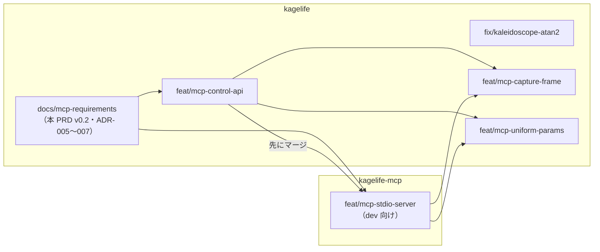
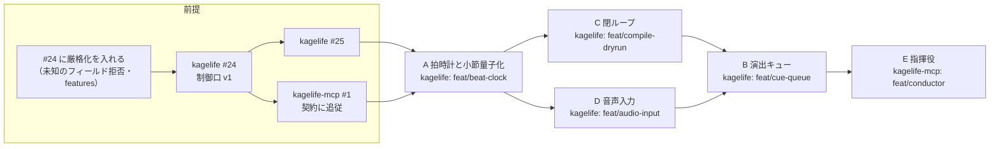

# PRD: KageLife

**バージョン**: 0.5
**作成日**: 2026-04-18
**更新日**: 2026-10-22
**ステータス**: v0.1 部分と v1.0 へ前倒しした機能（v0.3）は Approved / v0.2 追加分（MCP）は Draft / v0.5 追加分（段階 3: 自律演出）は Draft（方針は 2026-10-19 に決定済み）
**オーナー**: cyokozai

### 変更履歴

| 版 | 日付 | 内容 |
|----|------|------|
| 0.1 | 2026-04-18 | 初版 |
| 0.2 | 2026-09-30 | MCP 連携（LLM 共演 VJ）の章を追加。依存表・スコープ・未解決事項を更新。本番 VJ 中の障害対応を付録に追加。前提は [assumptions-20260930.md](assumptions-20260930.md)。MCP サーバは別リポジトリ `cyokozai/kagelife-mcp` に置く（同日決定） |
| 0.3 | 2026-10-01 | 実装との整合。v1.0 へ前倒しした機能（タップBPM・クロスフェード・`Cursor` / `Frame` / `Random`・HUD・フルスクリーン・DPI 対応）の FR（FR-006・FR-007・FR-013〜FR-016・FR-023〜FR-025・FR-030〜FR-033・FR-040〜FR-042）を追加。In Scope のチェック、§7 の依存、NFR の実測値、Q-002 の補足を更新。クロスフェードの決定は [ADR-008](adr/ADR-008-crossfade-compositing.md)。制御口の BPM の扱いを D3 に合わせた（Q-008 をクローズ、FR-114・FR-115 と ADR-006 を改訂） |
| 0.4 | 2026-10-02 | 制御口 v1 の実装（PR #24）に合わせた ADR-006 の改訂（補足 14 の理由、補足 16〜18 の追加）に追従。FR-112 の差し替え先（ファイル名順の位置）と PUT で表示される条件を補足 14 に合わせ、FR-109 の参照を補足 1〜18 に広げた |
| 0.5 | 2026-10-22 | 2026-10-19 の決定を反映。LLM が曲に合わせて自分から演出を変える自律を**段階 3** として追加し（§12、FR-140〜FR-196）、拡張 A〜E のロードマップ・スコープ・ユーザーストーリー・成功指標・リスク・未解決事項（Q-009〜Q-017。Q-010 は 2026-10-22 にクローズ）を足した。LLM 利用料は段階 3 では演者自身の API キーで払う。音声解析は本体に同居させ、`-audio` を付けたときだけ有効にする。重い解析は外部のクライアントとし、制御口の既存の口に値を送る（[ADR-009](adr/ADR-009-audio-analysis-in-process.md)。2026-10-19 は別リポジトリに置く決定だったが、2026-10-22 に本体への同居へ変えた）。§7 に malgo を追加予定として記した。自律の位置づけ（LLM は予約、GUI が拍で実行、人の操作が優先）は [ADR-010](adr/ADR-010-autonomous-conductor.md)。制御口は #24 のマージ前に未知のフィールドを拒否し、state に `features` を出す（FR-140・FR-141、ADR-006 補足 19・20）。FR-109 の参照を補足 1〜20 に広げた |

---

## 1. エグゼクティブサマリー

KageLifeは、Ebitengine/Kageシェーダーをファイル保存だけでリアルタイム反映し、
キーボードで瞬時に切り替えられる、Go開発者のためのVJライブコーディングツール。

外部エディタ（VS Code / Neovim等）でKageシェーダーを編集・保存すると、
即座に画面に反映される。`Time`・`Resolution`などのUniformは自動で注入され、
キーボード（1〜9）で複数シェーダーを切り替えてVJパフォーマンスを行える。

**なぜ今やるか:**
Go/Ebitengineエコシステム内で完結するVJライブコーディングツールが存在しない。
KodeLife（GLSL専用）やHydra（Node.js依存）の代替として、
Goネイティブで動作する軽量ツールの需要がある。

**v0.2 の追加:**
LLM（Claude Desktop / Claude Code）を VJ の共演者にする MCP サーバを足す。
LLM はシェーダを書き換え、コンパイルエラーの行と列を読んで直し、BPM とクロスフェードを操作し、
画面を見て次の手を決める。GUI は常駐させ、別リポジトリ `cyokozai/kagelife-mcp` の別バイナリ `kagelife-mcp` が stdio を受けて
localhost の制御口へ中継するので、MCP クライアントが落ちても映像は止まらない（§11）。

**v0.5 の追加（段階 3: 自律演出）:**
LLM が曲に合わせて自分から演出を変えられるようにする。LLM の応答は 1〜15 秒かかり、120 BPM の 1 拍（0.5 秒）にも 1 小節（2 秒）にも間に合わない。
そこで拍に合わせる処理は常駐 GUI に置き、LLM には数小節先の演出を予約させる。LLM を呼ぶのは曲の変わり目だけで、利用料は演者自身の API キーで払う。
人の操作は予約より優先する。前提となる拡張 A〜D（拍時計、演出キュー、シェーダ生成の閉ループ、本体に同居させる音声入力）を先に作り、自律（E）はその後に作る（§12）。

---

## 2. 目標と成功指標

### 技術目標

| 目標 | 指標 | 目標値 |
|------|------|--------|
| ホットリロード応答性 | 保存〜画面反映レイテンシ | < 200ms |
| 安定性 | コンパイルエラーでもクラッシュしない | エラー時に前のシェーダーを維持 |
| 起動速度 | 起動〜最初の描画 | < 2秒 |
| クロスプラットフォーム | 対応OS | macOS (arm64/amd64) + Linux (amd64/arm64) |
| MCP 応答性（v0.2） | ツール呼び出し〜画面反映（LLM の生成時間を除く） | < 200ms |
| MCP 分離（v0.2） | MCP 側の障害で描画が止まらない | MCP クライアント終了・中継の異常時も 60fps を維持 |
| 拍への同期（v0.5） | 量子化した切り替え・予約した演出の、拍頭・小節頭からのずれ | 1 フレーム以内（60fps で 16.7ms 以内） |
| 人の操作の優先（v0.5） | キー操作が予約された演出に打ち消されない | キー操作の後、予約が人の選んだ状態を上書きした回数 0 |
| LLM 呼び出しの頻度（v0.5） | 自律演出で LLM API を呼ぶ契機 | 曲の変わり目ごとに 1 回の判断（シェーダ生成の修正の往復を除く）。拍・小節ごとには呼ばない |
| 自律の分離（v0.5） | 指揮役・外部の推定器の障害、音声デバイスの不調で描画と予約済みの演出が止まらない | 指揮役・外部の推定器の終了時、デバイスが無い・抜けたときも 60fps を維持し、キューは繰り返しを続ける |
| 音への同期（v0.5） | オンセットと拍時計のずれ | 同じプロセスの同じ時計で扱い、uniform への反映はフレーム単位でそろう（`-audio` 有効時） |

---

## 3. スコープ

### In Scope（MVP v1.0）

- [x] `.kage`ファイルのホットリロード（fsnotify + 自動再コンパイル）
- [x] `Time` / `Resolution` Uniformの毎フレーム自動注入
- [x] 複数シェーダーをキー（1〜9）で切り替え
- [x] コンパイルエラー時に前のシェーダーを維持（クラッシュしない）
- [x] 起動時にシェーダー一覧をターミナル表示
- [x] `*ebiten.Shader`の明示的`Dispose()`によるメモリ管理

### In Scope（v1.0 へ前倒しした機能）

当初は V2+ または Could としていたが、実装が先行したため v1.0 に含める。要件は §5 の FR-013 以降・FR-023 以降・FR-030 以降・FR-040 以降に記す。

- [x] タップBPMと`Beat` Uniform（スペースキー）
- [x] クロスフェード（Shift+数字キー、`[` `]`で拍数を変更）。合成方式などの決定は [ADR-008](adr/ADR-008-crossfade-compositing.md)
- [x] `Cursor` / `Frame` / `Random` Uniformの毎フレーム自動注入
- [x] HUD 表示（Hキーで切り替え）
- [x] フルスクリーン切り替え（Fキー）
- [x] ウィンドウのリサイズとDPI対応（`LayoutF`）

### In Scope（MCP MVP、v0.2 追加）

| 項目 | 内容 | リポジトリ: ブランチ | 段階 |
|------|------|---------|------|
| 制御口 v1 | 127.0.0.1 限定 HTTP/JSON、トークン認証、発見ファイル、Update キュー（ADR-006） | kagelife: feat/mcp-control-api | 1 |
| MCP 中継 | 別バイナリ `kagelife-mcp`（stdio、純 Go）と 8 ツール（FR-110〜FR-117） | kagelife-mcp: feat/mcp-stdio-server | 1 |
| 画面の確認 | capture_frame（FR-120） | kagelife: feat/mcp-capture-frame ＋ kagelife-mcp 側のツール追加 | 2 |
| ユーザー定義 uniform | set_uniform（FR-130、Q-001 の決着） | kagelife: feat/mcp-uniform-params ＋ kagelife-mcp 側のツール追加 | 2 |

段階 1 の 2 本（別リポジトリ）は並行して作り、control-api を先にマージする。段階 2 は段階 1 のマージ後に作る。

段階 1 の制御口には、#24 のマージ前に契約の厳格化（未知のフィールドの拒否と `features`。FR-140・FR-141）を入れる。kagelife-mcp #1 はこれに追従する（FR-142）。

### In Scope（段階 3: 自律演出、v0.5 追加）

LLM が曲に合わせて自分から演出を変える。前提の A〜D を先に作り、自律の本体（E）は A〜D の後に作る。要件は §12。ブランチ名は仮。

| 拡張 | 内容 | リポジトリ: ブランチ（仮） | 段階 |
|------|------|---------|------|
| A 拍時計と小節量子化 | switch / crossfade の `at: "beat"\|"bar"\|"phrase"`、拍の通し番号・小節内の位置の uniform、`POST /v1/tap`、拍頭を指定できる set_bpm（FR-150〜FR-155） | kagelife: feat/beat-clock ＋ kagelife-mcp 側のツール引数 | 3（前提） |
| B 演出キュー | `POST /v1/cues` に `[{at_bar, action, ...}]` を積み、GUI が小節頭で実行する。キューが空なら繰り返す（FR-160〜FR-166） | kagelife: feat/cue-queue ＋ kagelife-mcp 側のツール追加 | 3（前提） |
| C シェーダ生成の閉ループ | `POST /v1/compile`（dry-run）、ファイルごとのエラー一覧、capture_frame（FR-170〜FR-173） | kagelife: feat/compile-dryrun ＋ kagelife-mcp 側のツール追加 | 3（前提） |
| D 音声入力 | 本体に同居させ、`-audio`（仮）を付けたときだけマイク／ループバックを取り込む。FFT・オンセット検出は純 Go で行い、帯域レベルを uniform として注入する。重い解析（BPM の推定器など）は外部のクライアントとし、`/v1/bpm`・`/v1/tap` に送る（FR-180〜FR-186、[ADR-009](adr/ADR-009-audio-analysis-in-process.md)） | kagelife: feat/audio-input | 3（前提） |
| E 常駐の指揮役 | kagelife-mcp の別バイナリ `kagelife-conductor`。Now Playing で曲の変わり目を検知し、LLM API で候補選び・シェーダ生成・キュー予約を行う（FR-190〜FR-196、[ADR-010](adr/ADR-010-autonomous-conductor.md)） | kagelife-mcp: feat/conductor | 3 |

マージ順は、前提（#24 の厳格化 → #24 → #25、kagelife-mcp #1 の契約追従）→ A → C と D を並行 → B → E（§9）。

### Out of Scope（明示的に除外）

- シェーダー重ね合わせ（V2: DrawRectShader複数パス設計が必要。v1.0 のクロスフェードは 2 枚の遷移に限る）
- GUIパラメータUI（V2: ImGui/tview統合コスト高）
- Ableton Link / MIDI連携（V2: Go実装が少ない）
- WASM対応（V2: ホットリロードと根本的に相性が悪い）
- 頂点シェーダー（Kageの仕様上フラグメントシェーダのみ）
- （v1.0）カスタムUniform。定義方式は Q-001 のとおり MCP 段階 2 の set_uniform（FR-130）で決める
- （v0.2）差分でのシェーダ編集。write_shader は丸ごと置き換え
- （v0.2）重いシェーダの自動ロールバック。MVP は get_state の fps で知らせるだけ
- （v0.2）シェーダの削除・リネーム
- （v0.2）ループバック以外からの制御、MCP の Streamable HTTP トランスポート
- LLM 利用料の負担。kagelife 側で課金・立て替え・鍵の配布はしない。段階 1・2 は利用者の Claude 契約で賄う。段階 3 の指揮役は演者自身の API キーで LLM API を呼び、利用料も演者が払う（呼ぶのは曲の変わり目だけ。FR-191・FR-193）（v0.5 改訂）
- （v0.5）拍・小節ごとに LLM を呼ぶこと。拍に合わせる処理は GUI が持ち、LLM は数小節先を予約するだけ（ADR-010）
- （v0.5）kagelife-mcp への音声入力・音声解析の組み込み。kagelife-mcp は純 Go を保つ（ADR-009）
- （v0.5）重い音声解析（BeatNet などの BPM の推定器）の本体への組み込み。外部のクライアントとし、制御口の既存の口に値を送る（ADR-009）
- （v0.5）音声の特徴量を約 60Hz で外から受け取る新しい受け口（ADR-009。Q-010 でクローズ）
- （v0.5）E の初版での AgentJev（判断専用の小型モデル）の採用。まず Jev 無しで作り、ライブで使う機体で計ってから決める（FR-195）
- （v0.5）Now Playing 以外の手段（音声の照合など）による曲の識別

### 将来フェーズ（V2+）

- シェーダーレイヤー合成（最大9枚、加算合成 + アルファブレンド。[discovery-interview-v2.md](discovery-interview-v2.md) を参照）
- GUI（TUI）によるカスタムUniformパラメータのリアルタイム調整（パラメータ層は set_uniform と共有する。FR-131）
- WASMビルド（ファイルアップロード型プレビューア）
- Ableton Link / MIDI Clock受信

※ タップBPMは当初 V2+ としていたが（Day 5 の Could とも記載が食い違っていた）、v1.0 に前倒しした。

---

## 4. ユーザーストーリー

### ペルソナ

**VJ兼Goエンジニア（作者自身）**: Goを書けるVJアーティスト。
KageシェーダーをライブコーディングしながらVJパフォーマンスをしたい。

**LLM を共演者とする演者（v0.2 追加）**: 作者本人が、Claude Desktop または Claude Code に指示を出しながら演じる。
LLM はシェーダを書き、エラーを読んで直し、BPM とフェードを操作する。演者は必要ならキーボードで割り込む。
LLM は利用者ではなく、MCP のツールを呼ぶ共演者として扱う。観客は画面を見るだけ。

**自律演出を任せる演者（v0.5 追加）**: 作者本人が、曲を流しながら指揮役（`kagelife-conductor`）に演出を任せる。
LLM の利用料は自分の API キーで払う。任せている間もキーボードで割り込み、人の操作が予約より優先されることを期待する。

### ストーリーマップ

| Epic | ユーザーストーリー | 受け入れ条件 | 優先度 |
|------|-----------------|------------|--------|
| ホットリロード | シェーダーファイルを保存したら、200ms以内に画面に反映されてほしい | fsnotify検知 → 再コンパイル → 描画更新が200ms以内 | Must |
| エラー耐性 | コンパイルエラーが出ても画面が止まらないでほしい | エラー時に前のシェーダーを維持。エラー内容はターミナルに出力 | Must |
| Uniform自動注入 | Timeを書くだけでアニメーションしてほしい | `Time`・`Resolution`が毎フレーム自動で注入される | Must |
| シェーダー切り替え | キーボードでシェーダーをすぐ切り替えたい | 1〜9キーで対応するシェーダーに即時切り替え | Must |
| メモリ管理 | 長時間使ってもメモリが増え続けないでほしい | 再ロード時に旧Shaderをきっちり Dispose() する | Should |
| クロスフェード | 曲の拍に合わせてシェーダーを滑らかに移り変わらせたい | Shift+数字で、指定した拍数をかけて次のシェーダーへ遷移する | Should（v1.0 前倒し） |
| タップBPM | 曲のテンポをシェーダーに伝えたい | スペースキーのタップ間隔からBPMを求め、`Beat`に拍内の位相が入る | Should（v1.0 前倒し） |
| LLM 共演（v0.2） | LLM に頼んだシェーダがすぐ画面に出てほしい | write_shader → 反映 200ms 未満（生成時間を除く）。成功分は `shaders/` に残る | Must |
| LLM 共演（v0.2） | LLM がエラーを出しても映像が止まらず、LLM が自分で直してほしい | 前のシェーダを維持。行・列付きの diagnostics（範囲内・最大 10 件）が LLM に返る | Must |
| LLM 共演（v0.2） | LLM に状態を読ませ、拍に合わせてフェードさせたい | get_state / set_bpm / crossfade が使える | Must |
| LLM 共演（v0.2） | クライアントが落ちても映像は流れ続けてほしい | GUI は別プロセスで常駐。中継の失敗は isError で返り描画に影響しない | Must |
| LLM 共演（v0.2） | LLM に画面を見せて次の手を考えさせたい | capture_frame が縮小画像を返す | Must（段階 2） |
| 拍時計（v0.5） | 遅れて届いた指示でも、拍や小節の頭で切り替わってほしい | `at: "bar"` 付きの switch / crossfade が次の小節頭で 1 フレーム以内のずれで実行される | Must（段階 3 前提 A） |
| 演出キュー（v0.5） | LLM に数小節先の演出を予約させ、返事を待たずに曲が進んでほしい | `POST /v1/cues` の予約が指定の小節頭で実行される。キューが空になったら繰り返す | Must（段階 3 前提 B） |
| 閉ループ（v0.5） | LLM が本番の画面を崩さずにシェーダを試作・修正してほしい | `POST /v1/compile` がファイルにも Manager にも触れずに diagnostics を返す | Should（段階 3 前提 C） |
| 音への反応（v0.5） | 曲の低音や打撃にシェーダが反応してほしい | `-audio` を付けて起動すると、帯域レベルが uniform として毎フレーム入る。デバイスが無い・抜けたときも描画は続き、HUD と state に出る | Should（段階 3 前提 D） |
| 自律（v0.5） | 曲が変わったら、LLM が次の曲の演出を自分で組んでほしい | Now Playing の変化で指揮役が 1 回 LLM を呼び、候補選び・生成・予約まで終える | Must（段階 3 E） |
| 自律（v0.5） | 任せている最中でも、自分のキー操作を優先してほしい | キー操作の後、予約が人の選んだ状態を上書きしない（扱いの細部は Q-009） | Must（段階 3 E） |
| 自律（v0.5） | LLM の利用料が膨らまないでほしい | LLM を呼ぶのは曲の変わり目だけ。自分の API キーで払う | Must（段階 3 E） |

詳細は [discovery-interview-mcp.md](discovery-interview-mcp.md)。

---

## 5. 機能要件

### ホットリロード

**概要**: `shaders/`ディレクトリの`.kage`ファイルを監視し、変更時に自動再コンパイルする。

**詳細要件**:
- FR-001: 起動時に`shaders/`ディレクトリをスキャンし、全`.kage`ファイルをコンパイル・ロード
- FR-002: `fsnotify`で`shaders/`ディレクトリを監視し、Write/Createイベントを検知
- FR-003: イベント検知後、対象ファイルを再コンパイルし、成功時に`*ebiten.Shader`を差し替え
- FR-004: 再コンパイル時に旧`*ebiten.Shader`を`.Dispose()`で解放
- FR-005: コンパイルエラー時は旧`*ebiten.Shader`を維持し、エラーを`path:行:列: msg`の形式でstderrに出力。エラーはファイルごとに保持する
- FR-006: 同一ファイルへのイベントは 100ms のデバウンスでまとめる（Q-002 で確定）
- FR-007: シェーダーのスロット（キー`1`〜`9`との対応）はファイル名順に固定する。起動時の一覧は 1 始まりの番号で出力し、キーの番号と揃える

### Uniform自動注入

**概要**: 毎フレーム、標準Uniformを自動で`DrawRectShaderOptions.Uniforms`に注入する。

**詳細要件**:
- FR-010: `Time float32` — 起動からの経過時間（秒）を毎フレーム注入
- FR-011: `Resolution [2]float32` — 描画先の`{width, height}`を毎フレーム注入
- FR-012: Kageシェーダー側でこれらを宣言しなかった場合もエラーにしない（Kageの仕様上、未使用Uniformは無視される）
- FR-013: `Beat float32` — 最後のタップを拍頭とした拍内の位相（0〜1）を毎フレーム注入。BPM が未確定なら 0（v1.0 前倒し）
- FR-014: `Cursor [2]float32` — マウスカーソルの位置を毎フレーム注入（v1.0 前倒し）
- FR-015: `Frame int` — 起動からの `Update()` 回数を毎フレーム注入（v1.0 前倒し）
- FR-016: `Random float32` — 0〜1 の乱数をフレームごとに引き直して注入（v1.0 前倒し）

### シェーダー切り替え

**概要**: キーボード操作で複数シェーダーをリアルタイムに切り替える。

**詳細要件**:
- FR-020: キー`1`〜`9`で対応するインデックスのシェーダーに即時切り替え
- FR-021: 起動時とシェーダー追加時にターミナルへシェーダー一覧を出力
- FR-022: 存在しないインデックスを押しても何も起きない（エラーにしない）
- FR-023: Shift+`1`〜`9`で、現在のシェーダー（A）から指定したシェーダー（B）へクロスフェードする（v1.0 前倒し）
- FR-024: フェードにかける拍数は`[`で減らし`]`で増やす。プリセットは 0.5 / 1 / 2 / 3 / 4 / 8 / 16 拍、既定は 4 拍（v1.0 前倒し）
- FR-025: フェード中の A と B の合成、フェード中の再指示、進み具合の計算は [ADR-008](adr/ADR-008-crossfade-compositing.md) の決定に従う

### タップBPM

**概要**: スペースキーのタップ間隔から BPM を求め、クロスフェードの長さと`Beat` Uniform に使う（v1.0 前倒し）。

**詳細要件**:
- FR-030: スペースキーの直近 8 回のタップ間隔の平均から BPM を求める
- FR-031: 前回のタップから 2 秒を超えて空いたタップは、新しい測定の 1 回目とみなす。このとき直前の BPM は保持する（ADR-008 D3）
- FR-032: まだタップしていないときは既定の 120 BPM で拍を刻む（ADR-008 D3）
- FR-033: BPM は 40〜300 に制限する（ADR-008 D3）。タップで測った BPM かどうかは`Measured()`で判別できる（HUD への表示は第 2 波）。制御口の set_bpm（FR-115）・crossfade（FR-114）も同じ範囲と既定値に従う（Q-008 で決定）

### 表示・ウィンドウ

**概要**: VJ 本番での操作を支える表示とウィンドウ操作（v1.0 前倒し）。

**詳細要件**:
- FR-040: `H`キーで HUD（BPM・フェード拍数・Mix 比・直近のエラー）の表示を切り替える。起動時は表示
  - アクティブなシェーダーが無いとき（`shaders/` が空、または全ファイルがコンパイルに失敗）も、HUD（表示中なら）とエラーを描く。起動時の読み込みエラーも HUD に出る
- FR-041: `F`キーでフルスクリーンを切り替える
- FR-042: ウィンドウのリサイズを許可し、`LayoutF`でデバイスのスケール係数を掛けた解像度で描画する（DPI 対応）

MCP 連携の機能要件（FR-100〜FR-131）は §11.3 に、段階 3 の機能要件（FR-140〜FR-196）は §12.4 に置く。

---

## 6. 非機能要件

| カテゴリ | 要件 | 測定方法 |
|---------|------|---------|
| レイテンシ | 保存〜画面反映 < 200ms | 統合テストで計測（W1-2 で追加、最悪 103.1 ms（Linux））。保存から `Events` を受け取るまでを 5 回測定（101.6 / 103.1 / 102.5 / 101.0 / 101.1 ms、デバウンス 100 ms、race 付き、Linux のコンテナ）。macOS は未確認 |
| 安定性 | コンパイルエラーでクラッシュしない | ユニットテスト |
| メモリ | 長時間実行でメモリリークなし | `runtime.ReadMemStats`で確認（未実測） |
| 起動 | 起動〜最初の描画 < 2秒 | 手動計測（未実測） |
| クロスプラットフォーム | macOS arm64/amd64 + Linux amd64/arm64 | GitHub Actionsのリリースビルドで確認（[ADR-003](adr/ADR-003-cross-platform.md) / [ADR-004](adr/ADR-004-cicd-release.md)） |

MCP 連携の非機能要件は §11.4 に、段階 3 の非機能要件は §12.5 に置く。

---

## 7. 外部依存

| ライブラリ | 役割 | バージョン方針 |
|----------|------|-------------|
| `github.com/hajimehoshi/ebiten/v2` | ゲームループ・シェーダーAPI・テキスト描画 | 最新stable（現在 v2.10） |
| `github.com/fsnotify/fsnotify` | ファイル監視 | 最新stable |
| `golang.org/x/image` | HUD のフォント（`font/gofont/goregular`。既存。v0.1 の表に記載漏れ） | 最新stable |

v0.2 でも kagelife 本体の依存は変えない（`golang.org/x/image` は記載漏れの訂正）。これ以上の直接依存を足すときは ADR を起こす。

MCP サーバ（別リポジトリ `cyokozai/kagelife-mcp`）の依存は次のとおり（ADR-007）。kagelife 本体には入らない。

| ライブラリ | 役割 | バージョン方針 |
|----------|------|-------------|
| `github.com/modelcontextprotocol/go-sdk` | MCP の stdio サーバ | v1.8.0 から。要求 Go 1.25 以上。間接依存が増える（ADR-007） |

段階 3（v0.5）の拡張 D で、kagelife 本体に次の直接依存を足す予定である（[ADR-009](adr/ADR-009-audio-analysis-in-process.md)。feat/audio-input で go.mod に入れる）。

| ライブラリ | 役割 | バージョン方針 |
|----------|------|-------------|
| `github.com/gen2brain/malgo` | 音声の取り込み（miniaudio を同梱。Unlicense）。`-audio` を付けたときだけデバイスを開く | 最新stable（追加予定）。cgo の指定は Linux で `-ldl -lpthread -lm` だけで、バックエンドは実行時に読み込む |

FFT とオンセット検出は純 Go で書き、依存を足さない。kagelife-mcp には音声の依存を入れない（純 Go を保つ）。
指揮役（`kagelife-conductor`、kagelife-mcp の別バイナリ）が LLM API と Now Playing の取得に使う依存は、E の着手時に kagelife-mcp 側で決める（ADR-007 の方針に従い、純 Go を保つ）。

---

## 8. リスクと軽減策

| リスク | 影響度 | 発生確率 | 軽減策 |
|-------|-------|---------|--------|
| `ebiten.NewShader()`の繰り返し呼び出しでメモリリーク | High | Mid | Day 1のPoCで確認。Dispose()を必ず実装 |
| ホットリロードレイテンシが200msを超える | Mid | Low | fsnotifyのデバウンス調整で対処 |
| fsnotifyのmacOSイベントが重複発火 | Mid | High | デバウンス処理（100ms）を実装 |
| （v0.2）LLM が書いた重いシェーダで fps が落ちる | High | Mid | get_state で fps を知らせる。演者は 1〜9 キーで既知のシェーダへ戻す（付録 B）。自動ロールバックは後回し |
| （v0.2）MCP クライアントの終了で映像が落ちる | High | Mid | 常駐 GUI ＋ 中継の構成（ADR-005） |
| （v0.2）制御口への不正な要求 | Mid | Low | 127.0.0.1 限定、起動時トークン、名前の正規表現、64KiB 上限（ADR-006） |
| （v0.2）macOS 実機で ReadPixels が遅い、最小化時に Update が止まる | Mid | 不明 | 未確認。capture_frame は呼ばれたときだけ取得。ループが 2 秒応答しなければ `loop_timeout` |
| （v0.2）構文エラーの件数が膨らみ LLM の文脈を浪費する | Low | High | diagnostics をソースの行数以内・最大 10 件に絞る |
| （v0.2）kagelife と kagelife-mcp の間で制御口の契約がずれる | Mid | Mid | 契約の正典を ADR-006 に 1 か所だけ置く。発見ファイルの `version`（1 固定）で食い違いを検出し、1 以外は接続しない |
| （v0.5）任意機能（A〜D）の有無が GUI の版によって違い、中継・指揮役が無い機能を呼ぶ | Mid | High | `GET /v1/state` の `features` で有無を確かめてから使う。`version` は 1 のまま上げない（FR-141、ADR-006 補足 20） |
| （v0.5）要求の綴り違い（例: `at` を `at_bar` と書く）が黙って無視され、即時に実行される | High | Mid | 制御口は未知のフィールドを 400 `invalid_request` で拒否し、message にフィールド名を入れる（FR-140、ADR-006 補足 19） |
| （v0.5）LLM の応答（1〜15 秒）が拍・小節に間に合わない | High | High | 拍に合わせる処理は GUI に置き、LLM は数小節先を予約する（ADR-010） |
| （v0.5）予約が人の操作を打ち消し、演者が制御を失う | High | Mid | 人の操作をキューより優先する（FR-164）。扱いの細部は Q-009 |
| （v0.5）LLM の利用料が膨らむ | Mid | Mid | LLM を呼ぶのは曲の変わり目だけ。演者自身の API キーで払う（FR-191・FR-193） |
| （v0.5）API キーの漏洩 | High | Low | キーは指揮役の環境変数でだけ受け取り、発見ファイル・ログ・制御口に載せない（FR-193） |
| （v0.5）音声入力のライブラリ（malgo）で本体のビルド条件が変わる | Low | Low | cgo の指定は Linux で `-ldl -lpthread -lm` だけで、バックエンドは実行時に読み込む。CI とコンテナは ALSA の開発パッケージをすでに入れている。4 ターゲットのビルドは feat/audio-input で確かめる（ADR-009） |
| （v0.5）音声のコード（C の miniaudio）が描画と同じプロセスで異常を起こす | Mid | Low | `-audio` を付けたときだけ有効にし、既定は無効。コールバックから `Update()` へは最新値だけを渡す（ADR-009） |
| （v0.5）音声デバイスが無い・許可が無い・途中で抜ける | Mid | Mid | 描画は止めず、HUD と state に出す。帯域レベルの uniform は 0 に戻す（FR-182・FR-184） |
| （v0.5）Mac でループバック（再生中の音）を取れない | Mid | 不明 | 未確認（Q-011）。取れない間はマイク入力で代える |
| （v0.5）macOS のマイクの利用許可が想定と違うアプリに付く | Low | 不明 | 未確認（Q-017）。素のバイナリでは起動したターミナルのアプリに付く見込み |
| （v0.5）指揮役・外部の推定器が落ちる | Mid | Mid | 別プロセスなので描画は続く。キューは繰り返しを続け、BPM は最後に設定された値のまま進む（FR-165） |

---

## 9. タイムライン

| マイルストーン | 内容 | 目標日 |
|-------------|------|--------|
| Day 1 | PoC: `ebiten.NewShader()`再呼び出し・Dispose確認 | 2026-04-19 |
| Day 2-3 | Core: fsnotify + Time/Resolution Uniform | 2026-04-21 |
| Day 3-4 | Core: 複数シェーダー管理 + キー切り替え | 2026-04-22 |
| Day 5 | Could: タップBPM or カスタムUniform（タップBPMを実装。カスタムUniformは MCP 段階 2 の set_uniform へ先送り） | 2026-04-23 |
| Day 6 | テスト・リファクタリング | 2026-04-24 |
| Day 7 | README + GitHub Release v1.0 | 2026-04-25 |

### v0.2 ブランチ計画（MCP）

すべて dev から切って dev へ出す。統合ブランチは挟まない。リポジトリは kagelife と kagelife-mcp（public、main ← dev ← feat）の 2 つ。

| リポジトリ | ブランチ | 内容 | 順序 |
|-----------|---------|------|------|
| kagelife | fix/kaleidoscope-atan2 | `shaders/06_kaleidoscope.kage` の `atan` を `atan2` に直す | 独立 |
| kagelife | docs/mcp-requirements | 本 PRD v0.2、ADR-005〜007、ヒアリング記録、前提合意書 | 最初 |
| kagelife | feat/mcp-control-api | 制御口 v1（ADR-006） | 段階 1。先にマージ |
| kagelife-mcp | feat/mcp-stdio-server | `kagelife-mcp` と 8 ツール | 段階 1。control-api と並行、後にマージ |
| kagelife（＋ kagelife-mcp） | feat/mcp-capture-frame | 制御口の `/v1/capture` と capture_frame ツール | 段階 2 |
| kagelife（＋ kagelife-mcp） | feat/mcp-uniform-params | 制御口の `/v1/uniforms`・uniform の抽出と set_uniform ツール | 段階 2 |

### 段階 3 ブランチ計画（自律演出、v0.5）

2026-10-19 決定（音声の置き場所は 2026-10-22 に変更）。リポジトリは kagelife と kagelife-mcp の 2 つのまま（音声は本体に同居させる。2026-10-22 決定、ADR-009）。ブランチ名は仮。

| 順序 | リポジトリ | ブランチ（仮） | 内容 |
|------|-----------|---------|------|
| 前提 1 | kagelife | feat/mcp-control-api-v2（#24） | マージ前に FR-140・FR-141（ADR-006 補足 19・20）を入れる |
| 前提 2 | kagelife | #24 → #25 の順にマージ | 制御口 v1 とその配線 |
| 前提 3 | kagelife-mcp | feat/mcp-stdio-server（#1） | 契約の追従（FR-142） |
| 1 | kagelife（＋ kagelife-mcp） | feat/beat-clock | A（FR-150〜FR-155） |
| 2（並行） | kagelife（＋ kagelife-mcp） | feat/compile-dryrun | C（FR-170〜FR-173） |
| 2（並行） | kagelife | feat/audio-input | D（FR-180〜FR-186）。malgo を go.mod に足す |
| 3 | kagelife（＋ kagelife-mcp） | feat/cue-queue | B（FR-160〜FR-166） |
| 4 | kagelife-mcp | feat/conductor | E（FR-190〜FR-196）。まず AgentJev 無しで作る |

---

## 10. 未解決事項

| ID | 内容 | 期限 |
|----|------|------|
| Q-001 | カスタムUniformの定義方法（`.kage`コメント解析 vs 別ファイル） | **決着予定**: シェーダ内の大文字で始まるグローバル宣言を `go/parser` で抽出する方式（PoC で 9 本すべてから名前と型を抽出できた）。別ファイル方式は採らない。feat/mcp-uniform-params で確定 |
| Q-002 | fsnotifyのデバウンス時間の最適値（候補: 50ms / 100ms） | **決着**: 100ms（現行実装・README）。保存〜画面反映の時間は統合テストで測る（W1-2 で追加、最悪 103.1 ms（Linux）。目標 < 200ms を満たす。macOS は未確認） |
| Q-003 | macOS（Metal）実機での ReadPixels の速さ、ウィンドウ最小化時の `Update()` の挙動 | feat/mcp-capture-frame の前に実機で確認 |
| Q-004 | Claude Desktop への接続と、stdio サーバが返す画像の上限（未確認） | feat/mcp-capture-frame で確認 |
| Q-005 | set_uniform で受け付ける型の範囲と、値の検査（予約 uniform は対象外） | feat/mcp-uniform-params |
| Q-006 | dev から main へ上げるときの衝突の有無（main にしか無いコミットが 6 本） | 次の dev → main 昇格の前 |
| Q-007 | 既存の問題: `internal/filewatcher` の `TestDebounce_SingleEvent` が `-race` でデータ競合する（MCP の範囲外で見つかった） | 別 PR で修正（W1-2 でデバウンスのデータ競合を修正した。[ADR-002](adr/ADR-002-hotreload-mechanism.md) の注記。本件が解消したかは dev で `-race` を回して確認する） |
| Q-008 | 制御口の BPM の扱いと [ADR-008](adr/ADR-008-crossfade-compositing.md) D3 の食い違い（制御口は BPM 0 を「未設定」としてクロスフェードを拒み、set_bpm の範囲も D3 と違っていた）。**クローズ: 制御口を D3 に合わせる（2026-10-01 決定）**。BPM は常に 40〜300 でタップ前は 120、BPM による crossfade の失敗は無くし、set_bpm は 40〜300 とした。state に `bpm_measured` を足した（ADR-006 改訂、FR-114・FR-115） | feat/mcp-control-api の前に決める（決定済み） |
| Q-009 | 演出キューと人の操作の優先の細部。人がキー操作をしたとき、予約済みのキューを捨てるか、一時停止するか、そのまま続けて人の選んだ状態だけを守るか。再開の条件（時間・次の曲・明示の操作）。制御口からの即時の操作（MCP 経由の人の指示）を「人の操作」に含めるか（FR-164、ADR-010） | B（feat/cue-queue）の着手前 |
| Q-010 | 60Hz の特徴量（帯域レベル）の受け口を HTTP にするか UDP にするか。**クローズ: 受け口は作らない（2026-10-22 決定）**。音声の取り込みと FFT・オンセット検出は本体に同居させ、帯域レベルはプロセスの中で uniform に渡す。重い解析は外部のクライアントとし、既存の `/v1/bpm` と拡張 A の `/v1/tap`・拍頭の指定に送る（ADR-009） | D の着手前に決める（決定済み） |
| Q-011 | Mac でのループバック（再生中の音）の取り方。仮想音声デバイスを演者に入れてもらうか、OS の画面・音声の取得の仕組みを使うか、マイクだけにするか（FR-180、ADR-009） | D の着手前に実機で確認 |
| Q-012 | BPM の出どころの優先。外部の推定器（BeatNet など）が `/v1/bpm`・`/v1/tap` に送る値と、演者のタップ・set_bpm のどちらを優先するか。本体のオンセットから BPM を推定するか、オンセットは uniform に渡すだけにするか（FR-183） | D の着手前 |
| Q-013 | 拍子とフレーズの長さ。拍子を 4/4 に固定するか、`at: "phrase"` の 1 フレーズを何小節にするか（既定と変更の手段）（FR-150・FR-151） | A（feat/beat-clock）の着手前 |
| Q-014 | Now Playing の取得手段（macOS で再生中の曲の情報をどこから読むか）と、取れないときの曲の変わり目の代わりの合図（FR-191） | E（feat/conductor）の着手前 |
| Q-015 | AgentJev の計り方。ライブで使う機体で、何を（小節ごとの選択の遅延・メモリ・選択の妥当さ）どの基準で計り、採否を決めるか（FR-195、ADR-010） | E の初版（Jev 無し）の後 |
| Q-016 | `features` に載せる名前の一覧の正典の置き場所（ADR-006 の表に載せていく案）と、A〜D の各 PR が付ける名前（FR-141） | A の PR で最初の名前を足すとき |
| Q-017 | macOS のマイクの利用許可の帰属。配布物は `.app` ではなく tar.gz の素のバイナリなので、許可は起動したターミナルのアプリに付く見込み（未確認）。演者への案内（初回の許可の出し方、拒否したときの戻し方）をどう書くか（FR-180・FR-184、ADR-009） | D の着手前に macOS 実機で確認 |

---

## 11. MCP 連携（v0.2 追加）

### 11.1 目的

LLM を VJ の共演者にする。LLM がシェーダを書き換え、結果（成否・エラーの位置・状態・画面）を受け取って次の手を決められるようにする。
現状、外部から状態を変える手段はファイル変更だけで、結果を返す経路が無い。これを、描画を止めずに足す。

前提は [assumptions-20260930.md](assumptions-20260930.md)、構成は ADR-005（MCP サーバは別リポジトリ `cyokozai/kagelife-mcp`）、制御口は ADR-006、SDK は ADR-007。

### 11.2 ユースケース

| # | ユースケース | 主なツール |
|---|------------|-----------|
| UC-1 | 演者の指示で LLM が新しいシェーダを書き、画面に出す | get_kage_guide → write_shader → switch_shader |
| UC-2 | LLM がコンパイルエラーの行と列を読んで直す | write_shader（失敗）→ write_shader（修正版） |
| UC-3 | LLM が BPM を設定し、拍に合わせてクロスフェードする | get_state → set_bpm → crossfade |
| UC-4 | LLM が既存のシェーダを読み、手を加えて書き戻す | list_shaders → read_shader → write_shader |
| UC-5 | LLM が画面を見て、見た目を踏まえて次の手を決める | capture_frame（段階 2） |
| UC-6 | LLM がシェーダのパラメータを動かす | set_uniform（段階 2） |

### 11.3 機能要件

#### 構成・起動

- FR-100: `kagelife` は起動時に 127.0.0.1 限定の制御口を開く（`-control-addr`、既定 `127.0.0.1:0`）。ループバック以外を指定したら起動エラー（判定は IP リテラルの 127.0.0.0/8 と ::1 だけ。`localhost`・`0.0.0.0` も起動エラー）
- FR-101: `kagelife` は起動時に発見ファイル（addr / token / pid / shader_dir / version）を 0600 で書き、正常終了時に消す（中の token が自分のものと一致するときだけ）。`version` は 1 固定。場所は `KAGELIFE_CONTROL_FILE`、無ければ `os.UserCacheDir()/kagelife/control.json`
- FR-102: `kagelife-mcp` は別リポジトリ `cyokozai/kagelife-mcp` の別バイナリで、MCP クライアントが起動する stdio の MCP サーバとして動く。cgo も ebiten も使わない純 Go とする。stdout は JSON-RPC 専用、ログは stderr。kagelife 本体に `mcp` サブコマンドは作らない
- FR-103: `kagelife-mcp` はツール呼び出しのたびに発見ファイルを読み、Bearer トークン付きで制御口へ中継する
- FR-104: 制御口に届かない（発見ファイルが無い・接続拒否・タイムアウト・2xx 以外）ときは、ツールの結果を `isError` 付きで返す。`error` と `message`（`compile_error` なら `diagnostics`）を LLM が読める形にする
- FR-105: stdin が EOF になったら `kagelife-mcp` は正常終了する
- FR-106: 制御口の要求は返信チャネル付きのコマンドとして `Update()` が処理する。`Update()` は毎 tick キューを読み切る。ループが 2 秒以内に応答しなければ 503 `loop_timeout`
- FR-107: シェーダは index ではなく名前（ファイル名から `.kage` を除いたもの）で指定する。名前は `^[a-z0-9][a-z0-9_-]{0,63}$`。GET・PUT・switch・crossfade のすべてで検査し、エスケープはデコードしてから検査する
- FR-108: `kagelife-mcp` は発見ファイルの `version` が 1 以外なら接続せず、版の食い違いを `isError` で返す
- FR-109: 制御口の細かな振る舞い（`invalid_request`・`internal_error`、crossfade の判定順、`created` と `last_error` の扱い、本文の上限 1MiB、コンパイルに失敗したファイルの扱い、フェード中の再指示、`last_error.message` の形、未知のフィールドの拒否、`features` など）は ADR-006 の補足 1〜20 に従う

#### MCP ツール（段階 1: 8 種）

- FR-110: `list_shaders` — シェーダ名の一覧とアクティブなシェーダを返す（GET /v1/state）
- FR-111: `read_shader` — 指定したシェーダのソースを返す（GET /v1/shaders/{name}）
- FR-112: `write_shader` — ソースを丸ごと置き換える（PUT /v1/shaders/{name}）。検査の順は、名前 → 64KiB 上限 → `//kage:unit pixels` 必須 → コンパイル。コンパイルに成功したときだけ、一時ファイル＋rename で `shaders/<名前>.kage` に保存して差し替える（無ければファイル名順の位置に追加）。成功してもアクティブにはしない（例外として、アクティブがコンパイルに失敗したファイルの nil のスロットを指しているとき、またはスロットが 0 本のときに PUT が成功すると、そのシェーダーが表示される。ADR-006 補足 14）。失敗したらファイルに触れず、ソースの行数以内・最大 10 件の diagnostics（行・列・メッセージ）を返す
- FR-113: `switch_shader` — 指定したシェーダに即時に切り替える（POST /v1/switch）
- FR-114: `crossfade` — 指定したシェーダへ拍数でクロスフェードする（POST /v1/crossfade）。beats は 0 < beats <= 64、省略時は現在の拍数。BPM は常に 40〜300 で 0 にならないため、BPM を理由に失敗しない（タップ前は既定の 120 BPM。ADR-008 D3）
- FR-115: `set_bpm` — BPM を 40〜300 で設定する（POST /v1/bpm）。範囲外は 400 `invalid_bpm`。以後のタップテンポで上書きされてよい。get_state は BPM が既定値か設定・測定された値かを `bpm_measured` で返す（ADR-006、ADR-008 D3）
- FR-116: `get_state` — アクティブなシェーダ・一覧・BPM・フェード状態・fps・解像度・直近のエラー（ファイル監視経由の失敗も含む）を返す（GET /v1/state）
- FR-117: `get_kage_guide` — Kage の言語の制約（使える型、使えない構文、画像入力は最大 4 枚、`//kage:unit pixels` 必須）と予約 uniform（Time / Resolution / Beat / Cursor / Frame / Random）を返す。GUI 無しでも答える

#### MCP ツール（段階 2: 後続 PR）

- FR-120: `capture_frame` — 現在のフレームを縮小した画像を ImageContent で返す。長辺の既定は 1024px、形式は png または jpeg。各辺 2000px 以下。呼ばれたときだけ取得する（feat/mcp-capture-frame。制御口は `GET /v1/capture` を追加）
- FR-121: capture_frame の ReadPixels と縮小は `Update` / `Draw` の中で行い、画像の符号化はゲームループの外で行う
- FR-130: `set_uniform` — シェーダ内の大文字で始まるグローバル宣言（予約 uniform を除く）を `go/parser` で抽出し、その値を設定する。get_state に uniform の一覧を載せる（feat/mcp-uniform-params。制御口は `POST /v1/uniforms` を追加）
- FR-131: set_uniform のパラメータ層は、V2 で予定している TUI のパラメータ調整と共有する

### 11.4 非機能要件

| カテゴリ | 要件 | 測定方法 |
|---------|------|---------|
| フレームレート | MCP の呼び出し中も 60fps を維持 | get_state の fps。macOS 実機で手動確認 |
| 反映の速さ | ツール呼び出し → 画面反映 < 200ms（LLM の生成時間を除く） | 制御口の往復を計測。PoC（Xvfb）では差し替え 17ms。macOS 実機は未計測 |
| 画面取得（段階 2） | capture_frame の往復 < 200ms | PoC（Xvfb）では 19〜22ms（ReadPixels 1.6〜3.2ms、PNG 符号化 4〜5.5ms、オフスクリーン縮小なら約 1ms）。macOS 実機は未計測 |
| エラー耐性 | コンパイル失敗時は前のシェーダを維持し、ファイルも変えない | ユニットテスト（モックのコンパイラ） |
| 障害の分離 | MCP クライアントの終了・中継の異常・制御口のエラーで描画を止めない | 構成（ADR-005）と統合テスト |
| 応答の上限 | ループが 2 秒以内に応答しなければ `loop_timeout` | ユニットテスト |
| 安全性 | 127.0.0.1 限定、起動時トークン（32 バイト乱数）、発見ファイル 0600、名前の正規表現で `shaders/` 直下に限定、64KiB 上限 | ユニットテスト |
| 重いシェーダ | MVP では get_state の fps で知らせるだけ。自動で戻さない | — |
| 画像の大きさ | 各辺 2000px 以下。画像トークンは約 ⌈幅/28⌉×⌈高さ/28⌉（長辺 1280 で約 1200） | — |
| テスト | kagelife の `internal/control` は ebiten に依存させず、CGO 無しで CI を回す。kagelife-mcp は純 Go で、偽の制御口に対してテストする。両者を結合した E2E はリポジトリをまたぐので、macOS 実機で手動確認する。ウィンドウを伴うテストは CI に入れない（Alpine で SIGSEGV） | CI |

### 11.5 制約

- GUI は macOS ホストでネイティブに動かす。コンテナはビルドとテストだけ
- Claude Code は stdio サーバを自動で再接続しない
- Claude Desktop は画像対応と書かれているが、stdio サーバでの画像の上限は未確認
- Ebitengine v2.10.4 は `//kage:unit` 指定なし（texels）で行番号が 4 行ずれる

---

## 12. 自律演出（段階 3、v0.5 追加）

### 12.1 目的

LLM が曲に合わせて自分から演出を変えられるようにする（2026-10-19 決定）。
段階 1・2 では、LLM は演者の指示を受けて動く。段階 3 では、常駐の指揮役（`kagelife-conductor`）が曲の変わり目を検知して LLM を呼び、次の曲の演出を数小節先まで予約する。

位置づけの決定は [ADR-010](adr/ADR-010-autonomous-conductor.md)、音声解析の置き場所は [ADR-009](adr/ADR-009-audio-analysis-in-process.md)、制御口の契約は ADR-006。

### 12.2 原則

| 原則 | 内容 |
|------|------|
| 時間の分担 | LLM の応答は 1〜15 秒で、120 BPM の 1 拍（0.5 秒）にも 1 小節（2 秒）にも間に合わない。拍に合わせる処理（量子化・キューの実行）は GUI に常駐させ、LLM は数小節先を予約する |
| 呼ぶ契機 | LLM を呼ぶのは曲の変わり目だけ。拍・小節ごとには呼ばない。シェーダ生成の修正の往復（C の閉ループ）は、その曲の変わり目の 1 回の判断に含める |
| 利用料 | 演者自身の API キーで払う。kagelife 側は課金も立て替えもしない |
| 人が優先 | 人の操作は予約より優先する。細部は Q-009 |
| 順序 | 前提の A〜D を先に作り、自律（E）は A〜D の後に作る |
| 分離 | 指揮役と重い音声解析（外部の推定器）は別プロセスで、落ちても描画と予約済みの演出は止まらない。本体に同居させる音声入力は `-audio` を付けたときだけ有効で、デバイスの不調でも描画を止めない |

### 12.3 ユースケース

| # | ユースケース | 主な機能 |
|---|------------|---------|
| UC-7 | LLM の遅れた指示を、次の小節頭で切り替える | switch / crossfade の `at`（A） |
| UC-8 | LLM が次の数小節の演出を予約し、GUI が小節頭で実行する | `POST /v1/cues`（B） |
| UC-9 | LLM が本番の画面を崩さずにシェーダを試作し、エラーを直し、画面を見て確かめる | `POST /v1/compile`・ファイルごとのエラー一覧・capture_frame（C） |
| UC-10 | シェーダが曲の帯域レベルに反応する | `-audio` → 帯域レベルの uniform（D） |
| UC-11 | 曲が変わると、指揮役が LLM に候補選び・生成・予約をさせる | `kagelife-conductor`（E） |
| UC-12 | 任せている最中に演者がキーで割り込み、その選択が守られる | 人の操作の優先（B・E） |

### 12.4 機能要件

採番は §11.3 に続け、拡張ごとに 10 番ずつ取る（前提の契約: FR-140 番台、A: FR-150 番台、B: FR-160 番台、C: FR-170 番台、D: FR-180 番台、E: FR-190 番台）。
新しいエンドポイント・フィールド・uniform の名前のうち「仮」と書いたものは、各 PR で ADR-006 に契約として書くときに確定する。

#### 前提: 制御口の契約の厳格化（#24 のマージ前）

- FR-140: 制御口は、要求本文の JSON に契約に無いフィールドがあれば 400 `invalid_request` を返す。message にはそのフィールド名を入れる。#24 のマージ前に入れる（ADR-006 補足 19）
- FR-141: `GET /v1/state` に `features` を出す。常に配列（null にしない）で、要素は任意機能の snake_case の名前。今は空配列。A〜D の各 PR が自分の機能の名前を足す。発見ファイルの `version` は 1 のまま上げない（ADR-006 補足 20、Q-016）
- FR-142: `kagelife-mcp` は契約に追従する（#1）。要求には契約にあるフィールドだけを送り、応答の知らないフィールドは無視する。任意機能を使うツールは `features` で有無を確かめ、無ければ `isError` で GUI の版が古いことを返す

#### A: 拍時計と小節量子化

- FR-150: GUI は拍の通し番号と、小節内の位置を持つ。拍子とフレーズの長さは Q-013 で決める
- FR-151: switch / crossfade に `at`（`"beat"` / `"bar"` / `"phrase"`）を足す。指定すると、次のその境界で実行する。省略時は今までどおり即時に実行する。応答には実行する予定の拍の通し番号を返す（フィールド名は仮）
- FR-152: 拍の通し番号と小節内の位置を予約 uniform として毎フレーム注入する（名前は仮。決めたら get_kage_guide の予約 uniform にも足す）
- FR-153: `POST /v1/tap` — スペースキーのタップと同じ扱いのタップを外から送る
- FR-154: set_bpm（`POST /v1/bpm`）で拍頭を指定できる（例: 受け取った時点を拍頭にする。フィールド名は仮）
- FR-155: A を入れた GUI は `features` に A の名前（仮称 `beat_clock`）を載せる

#### B: 演出キュー

- FR-160: `POST /v1/cues` — `[{at_bar, action, ...}]` を受け取り、キューに積む。`at_bar` は拍時計（A）の小節の通し番号
- FR-161: GUI は `at_bar` の小節頭で `action` を実行する。`action` は制御口の既存の操作（switch / crossfade / set_bpm、段階 2 の後は set_uniform）に限り、各操作と同じ検査を積む時点で行う
- FR-162: 過ぎた小節を指定した予約の扱い（拒否するか、次の小節頭で実行するか）は B の PR で決める
- FR-163: キューの中身を読める（state に載せるか `GET /v1/cues` を足すかは B の PR で決める）
- FR-164: 人の操作はキューより優先する。人がキー操作をした後、予約がその選択を上書きしない。キューを捨てるか止めるか、再開の条件は Q-009
- FR-165: キューが空になったら、最後に実行した一巡を繰り返す（指揮役が落ちても演出が止まらない）
- FR-166: B を入れた GUI は `features` に B の名前（仮称 `cues`）を載せる

#### C: シェーダ生成の閉ループ

- FR-170: `POST /v1/compile` — ソースをコンパイルだけして、ファイルにも Manager にも触れない（dry-run）。検査の順と diagnostics の形は PUT（FR-112）と同じ
- FR-171: ファイルごとのエラー一覧を返す（`last_error` は最新の 1 件だけなので、コンパイルに失敗しているファイルをすべて、ファイル名と diagnostics の組で読めるようにする。state に載せるか別のエンドポイントにするかは C の PR で決める）
- FR-172: 指揮役は生成したシェーダを compile で直してから PUT し、capture_frame（FR-120）で画面を確かめる
- FR-173: C を入れた GUI は `features` に C の名前（仮称 `compile`）を載せる

#### D: 音声入力（本体に同居）

- FR-180: GUI のフラグ `-audio`（仮）を付けたときだけ、マイクまたはループバックから音声を取り込む。既定は無効。デバイスの指定を値に取るかは D の PR で決める（Mac でのループバックは Q-011、マイクの利用許可の帰属は Q-017）。取り込みは `internal/audio`（仮）で malgo を使う（ADR-009）
- FR-181: FFT による帯域レベルとオンセット検出は純 Go で行う。音声のコールバックのスレッドから `Update()` へは、ADR-002 の「channel に一本化」に沿って最新値だけを渡す（細部は D の PR）
- FR-182: GUI は帯域レベル（とオンセット）を予約 uniform として毎フレーム注入する（名前は仮。決めたら get_kage_guide の予約 uniform にも足す）。`-audio` が無効なとき、デバイスの不調のときは 0
- FR-183: 重い解析（BeatNet などの BPM の推定器）は外部のクライアントとする。値は制御口の既存の口（`POST /v1/bpm`、拡張 A の `POST /v1/tap` と拍頭の指定）に送る。約 60Hz の新しい受け口は作らない（Q-010 でクローズ）。外部の値とタップ・set_bpm の優先は Q-012
- FR-184: デバイスが無い・許可が無い・途中で抜けた場合も描画は止めない。HUD と state（または `last_error`）に出す
- FR-185: `-audio` で音声が有効な GUI は `features` に D の名前（仮称 `audio`）を載せる
- FR-186: kagelife-mcp には音声の依存を入れない（純 Go を保つ）。本体には malgo を直接依存として足す（§7、ADR-009）

#### E: 常駐の指揮役

- FR-190: 指揮役は kagelife-mcp リポジトリの別バイナリ `kagelife-conductor` とする。制御口への接続は `kagelife-mcp` と同じ手順（発見ファイルを読む、`version` 1、`features` で前提の A〜D を確かめる）
- FR-191: 指揮役は Now Playing で曲の変わり目を検知したときだけ LLM API を呼ぶ（取得手段は Q-014）
- FR-192: 1 回の判断で、既存のシェーダからの候補選び・必要ならシェーダ生成（C の閉ループ）・次の数小節のキュー予約（B）までを行う
- FR-193: LLM API の鍵は演者自身のものを、指揮役の環境変数でだけ受け取る。発見ファイル・ログ・制御口には載せない。利用料は演者が払う
- FR-194: 指揮役は人の操作の優先（FR-164）に従う。人が割り込んだ後に、その選択を打ち消す予約を積まない
- FR-195: 小節ごとの選択に AgentJev（判断専用の 0.6B モデル）を足すかは後で決める。E の着手時は、まず Jev 無しで作り、その後でライブで使う機体で計る（Q-015）
- FR-196: 指揮役が落ちても、映像と予約済みのキューは続く（キューが空なら繰り返す: FR-165）

### 12.5 非機能要件

| カテゴリ | 要件 | 測定方法 |
|---------|------|---------|
| 拍への同期 | 量子化した操作・予約の実行が拍頭・小節頭から 1 フレーム以内 | 拍時計の単体テスト（偽の時刻）。macOS 実機で目視 |
| フレームレート | 予約の実行中も、`-audio` で音声を取り込んでいる間も 60fps を維持 | get_state の fps。macOS 実機で手動確認 |
| 音の同期 | オンセットと拍時計を同じプロセスの同じ時計で扱い、uniform への反映がフレーム単位でそろう | `internal/audio` の単体テスト（偽の音声入力）。macOS 実機で目視 |
| LLM 呼び出し | 曲の変わり目ごとに 1 回の判断。拍・小節ごとに呼ばない | 指揮役のログで呼び出しの回数を数える |
| 障害の分離 | 指揮役・外部の推定器の終了、音声デバイスの不調で描画とキューが止まらない | 構成（ADR-009・ADR-010）と手動確認（デバイスを抜く） |
| 安全性 | API キーを発見ファイル・ログ・制御口に載せない | kagelife-mcp のテスト（ログに鍵が出ないこと） |
| 依存 | 本体に足す直接依存は malgo だけ（ADR-009）。kagelife-mcp に音声と cgo の依存を足さない | `go.mod` の確認、4 ターゲットのリリースビルド、kagelife-mcp の `CGO_ENABLED=0` ビルド |
| 契約の互換 | 任意機能の有無は `features` で示し、`version` は 1 のまま | 制御口のテスト |

### 12.6 制約

- LLM の応答は 1〜15 秒かかる（調査時の見積もり）。120 BPM では 1 拍 0.5 秒、1 小節 2 秒
- Now Playing の取得手段、Mac のループバック、macOS のマイクの利用許可の帰属は未確認（Q-011・Q-014・Q-017）
- AgentJev を採るかは、ライブで使う機体で計るまで決めない

---

## Appendix: 用語集

| 用語 | 定義 |
|------|------|
| Kage | EbitengineのGPUシェーダー記述言語。Go互換構文でフラグメントシェーダのみ対応 |
| Uniform | シェーダーへCPUから渡す定数。毎フレーム更新可能 |
| ホットリロード | ファイル保存時にコンパイル・画面反映を自動で行う仕組み |
| Dispose | `*ebiten.Shader`のGPUリソースを解放するメソッド |
| クロスフェード | 表示中のシェーダー（A）から次のシェーダー（B）へ、指定した拍数をかけて重ねながら移る遷移 |
| Mix | クロスフェードの進み具合（0 で A のみ、1 で B のみ） |
| MCP | Model Context Protocol。LLM クライアントが外部のツールを呼ぶための手順 |
| 制御口 | 常駐 GUI が 127.0.0.1 で開く HTTP/JSON の口（ADR-006） |
| 中継 | `kagelife-mcp`。別リポジトリ `cyokozai/kagelife-mcp` の別バイナリで、stdio の MCP を受けて制御口へ渡す（ADR-005） |
| 発見ファイル | 制御口のアドレスとトークンを書いたファイル（`control.json`） |
| diagnostics | コンパイルエラーの行・列・メッセージの一覧 |
| 量子化 | 操作の実行を次の拍頭・小節頭・フレーズ頭まで遅らせて揃えること（v0.5、拡張 A） |
| 演出キュー | 小節の通し番号と操作の組を積んでおき、GUI が小節頭で実行する仕組み（v0.5、拡張 B） |
| `features` | `GET /v1/state` が返す、GUI が持つ任意機能の名前の配列（ADR-006 補足 20） |
| `-audio` | 音声入力を有効にする GUI のフラグ（仮）。付けたときだけマイク／ループバックを取り込み、帯域レベルを uniform に渡す（ADR-009） |
| 外部の推定器 | BeatNet などの重い BPM の推定器。本体とは別のプロセスで動き、制御口の `/v1/bpm`・`/v1/tap` に値を送るクライアント（ADR-009） |
| 指揮役 | `kagelife-conductor`。kagelife-mcp の別バイナリで、曲の変わり目に LLM を呼んで演出を予約する（ADR-010） |
| AgentJev | 判断専用の 0.6B モデル。小節ごとの選択に後から足すかもしれない（FR-195） |

---

## Appendix B: 本番 VJ 中の障害対応

Runbook は作らない（assumptions-20260930 #14）。本番中に起こりうることと、その場の手当てだけを書く。

| 症状 | まず見る | 手当て |
|------|---------|--------|
| LLM の書いたシェーダで映像が重い・カクつく | get_state の fps | キーボード `1`〜`9` で既知のシェーダに戻す。LLM には軽くするよう指示する |
| LLM がコンパイルエラーを繰り返す | HUD（`H`）、get_state の last_error | 映像は前のシェーダのまま続く。そのまま LLM に直させるか、手で切り替える |
| MCP クライアントが落ちた・再起動した | 映像は続いているか | 映像は止まらない。クライアントを立ち上げ直し、MCP サーバに手動で再接続する（Claude Code は自動で再接続しない） |
| ツールが「GUI に接続できない」と返す | `kagelife` が動いているか | `kagelife` をリポジトリのルートで起動し直す。`kagelife-mcp` は呼び出しのたびに発見ファイルを読むので、クライアントの再接続は要らない |
| ツールが `loop_timeout` を返す | ウィンドウが最小化・背面になっていないか | ウィンドウを前面に戻す（macOS での最小化時の挙動は未確認） |
| `kagelife` 自体が落ちた | ターミナルのログ | 起動し直す。成功したシェーダは `shaders/` に保存済みなので作品は残る |
| （段階 3）予約された演出が意図に合わない | get_state の active・fade、キューの中身 | キーボードで割り込む。人の操作は予約より優先する（FR-164）。キューの扱いは Q-009 の決定に従う |
| （段階 3）指揮役が落ちた | 映像とキューが続いているか | 映像は止まらず、キューは繰り返しを続ける。指揮役を起動し直す |
| （段階 3）シェーダが音に反応しなくなった | HUD と state の音声のエラー、入力デバイス、`-audio` を付けて起動したか | 映像は止まらない（帯域レベルの uniform は 0）。デバイスをつなぎ直す。戻らなければ `-audio` を付けて `kagelife` を起動し直す |
